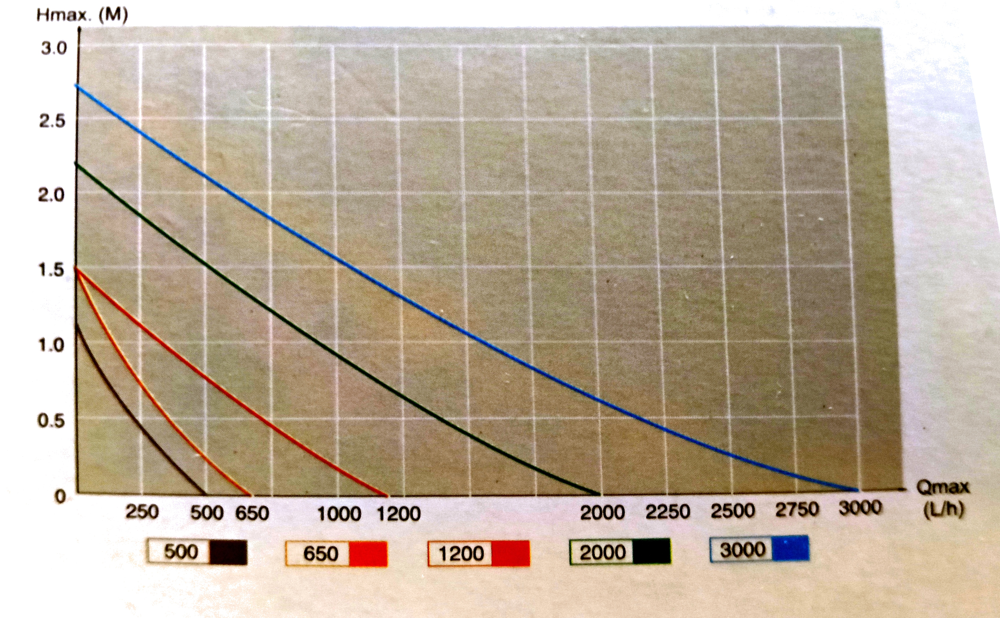
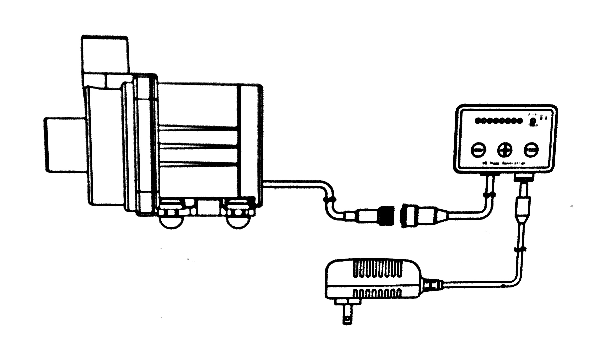
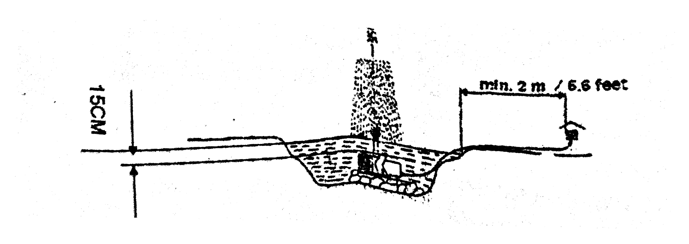
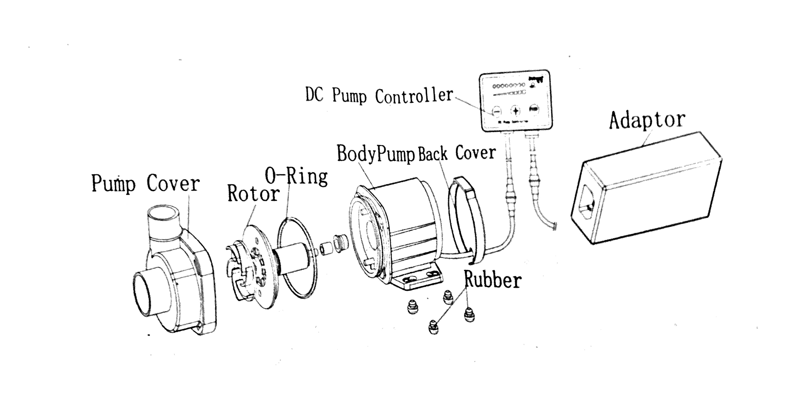

# Jebao DC Pump DC-500/DC-650 — transcripción del embalaje y del manual

Transcripción en inglés del texto visible en las fotografías del embalaje y del «DC Pump Owner’s Manual» entregadas por el propietario. Se normalizan los saltos de línea causados por la fotografía y la composición en Markdown. Se mantienen por separado los textos del embalaje y del manual, incluidas sus diferencias.

Las 21 fotografías incluyen primeros planos repetidos de algunas páginas. El texto único legible queda recogido aquí. Las figuras proceden de esas fotografías, con recorte, corrección geométrica de perspectiva y rotación, compensación de iluminación y limpieza del fondo. Se conservan los trazos, rótulos y curvas fotografiados; no se han redibujado.

## Embalaje

### Frontal

**DC PUMP**

**MARINE AQUA**

- High performance with innovative electronic motor, and energy saving up to 65%
- Super quiet operation
- IC electronic detection, automatic power-off protection upon no water
- Motor protection if rotor is blocked
- Used in marine water and fresh water
- With wear-resistant ceramic shaft, longer operation life

La caja muestra las denominaciones **DC-500** y **DC-650**; el ejemplar fotografiado está marcado para **DC-650**. También aparecen el logotipo **Jebao®**, los caracteres **捷寶**, la marca circular **EUROPEAN SPECIFICATION** y el texto:

> DC series — Professional for aquarium & pond

### Etiqueta del modelo

```text
JJ-DC650
DC650 + Controller 24V
```

Debajo aparece un código de barras.

### Curvas de caudal y altura impresas en la caja



Rótulos y escalas visibles:

- Eje vertical: `Hmax. (M)`; marcas 0, 0.5, 1.0, 1.5, 2.0, 2.5 y 3.0
- Eje horizontal: `Qmax (L/h)`; marcas 250, 500, 650, 1000, 1200, 2000, 2250, 2500, 2750 y 3000
- Leyenda de modelos: 500, 650, 1200, 2000 y 3000

### Esquema de conexión impreso en la caja



Junto al esquema aparecen estos textos:

```text
DC PUMP
Jebao Co., Ltd
E-mail: info@jebao.com
http://www.jebao.com
Made in China
CE
```

## Manual del propietario

### Portada e introducción

```text
DC PUMP
OWNER’S MANUAL
DC-500, DC-650
```

**INTRODUCTION**

> Jebao’s pumps are carefully inspected and tested to ensure both safety and operating performance. However, failure to follow the instructions and warnings in this manual may result in pump’s damage and/or serious injury. Be sure to read and save this manual for future reference.

### Facts

- High performance motor with innovation electronics, and energy saving up to 50% than before.
- IC electronic detection, automatic power-off protection upon no water
- Motor protection if rotor is blocked.
- Super Quiet Operation, The 8 times head and flow adjustable function
- Used in Marine Water and Fresh Water.
- No Copper Components
- With Wear-resistant Ceramic Shaft, Longer Operation Life
- 10 minutes FEED model (provide 10 min Pause and auto resume)

### Operation

1. The pump can be used indoor or outdoor, for underwater only.
2. Must be used with a AC 24V transformer at all times, an Jebao transformer is recommended to use with this pump.
3. Turn on power by pressing “+” on controller, one light on indicates speed/RPM1, continues to press “+” button if need until full speed/RPM, press “−” button to decrease speed/RPM.
4. Press “Feed” button for 10 minutes pause, “10 min” light’s on, pump will resume in 10 minutes, or press “Feed” button again to stop “feed” model..

> Please use a transformer with the correct wattage and never exceed the maximum wattage indicated on the transformer.

> Before plugging in the unit, be sure the input voltage indicated on your transformer is the same as your local power supply. If not, please do not operate the pump until you obtain the appropriate transformer from your local dealer.

### Especificaciones impresas

Antes de la tabla aparece esta instrucción:

> To reduce the risk of electrical shock, inspect all cords for damage before installation.

| No. | Model No. | Input rate | Output | Watts | Qmax (L/H) | Hmax (M) |
| ---: | --- | --- | --- | ---: | ---: | ---: |
| 1 | DC-500 | AC100-240V 50/60Hz | DC 24V 1A | 5 | 500 | 1.2 |
| 2 | DC-650 | AC100-240V 50/60Hz | DC 24V 1A | 8 | 650 | 1.5 |

> All the models the maximum operation depth is 1.5m.

### WARNING

- Do not connect to any voltage other than that shown on the rating label of the pump.
- Do not pump flammable liquids. The appliance is only intended to be used in aquarium.
- The maximum operation depth is 1.5m.
- Do not use with water above 35°C.
- The supply cord cannot be replaced. If the cord is damaged the appliance should be scrapped.
- The pump is not intended for use by young children or infirm persons without supervision.
- The maximum total head is 1.2m (for 500), 1.5m (for 650).
- To protect against the risk of electrical shock, do not immerse the plug in water or other liquid.
- This appliance is not intended for use by persons (including children) with reduced physical, sensory or mental capabilities, or lack of experience and knowledge, unless they have been given supervision or instruction concerning use of the appliance by a person responsible for their safety.
- Children should be supervised to ensure that they do not play with the appliance.

### CAUTION

- Always disconnect from electrical outlet before cleaning, maintenance and handling the pump.
- Don’t operate without water.
- Do not lift the pump by holding the power cord.
- Do not use the pump in liquids having a temperature exceeding 35°C. Use the pump only in freshwater.
- Please use the pump only when it is completely submerged in water.
- Must not use the pump in swimming pool.
- Automatic shut off if no water for 2 minutes.
- Pull the plug out, and re-insert for resuming work.

### PERFORMANCE

> A clogged or dirty intake screen will greatly reduce performance. If the pump is used on a dirty surface, raise it slightly to reduce the amount of debris contacting the intake. If less flow is desired, adjust the regulator on the sealing cover to restrict the flow.

> Do not let the pump run when not submerged in water. That may damage the pump. Always submerge the pump first, and then plug in the electrical outlet. At the beginning, it probably can’t pump water, because there is air in the pump and the tube. Don’t worry about it. Please pull out and insert electrical outlet several times, it will work normally.

**Used as submersible pumps (see fig. 1)**

> **IMPORTANT:** Do not let the pump run dry — this could cause damage to the motor.

- Submerse the pumps completely in your pond so as to make the pump body fill with water.
- A water level of approx. 15 cm (6 in.) is required for submersible use in order to prevent the pump from taking in air. (See fig. 1)
- To prevent the filter becoming prematurely clogged, place the pump above the mud in the pond!
- Install the enclosed filter sponge to prevent the inlet from becoming clogged.
- The pump is designed to accommodate 1 1/4″ internal threads as well as 1 1/4″ external threads through the socket (fountain jets, nozzles, water height regulators, standpipes, etc.).
- Running in conjunction with fountain jets, the pump should be stationed firmly and horizontally (on a brick).
- The pump can be switched on by simply plugging it in and switched off by plugging off.
- The water temperature should not exceed 35°C (95°F) and do not let the pump freeze in the wintertime.

**Figure 1**



En el papel también se ve el rótulo **Figure 2** después de este esquema; en las fotografías entregadas no se distingue un dibujo independiente asociado a ese segundo rótulo.

### MAINTENANCE



Las etiquetas del despiece son `Pump Cover`, `Rotor`, `O-Ring`, `BodyPump Back Cover`, `DC Pump Controller`, `Adaptor` y `Rubber`.

> Unplug before cleaning. To clean the pump, remove the back cover, sealing cover and the impeller. Use a small brush or stream of water to remove any debris.

> **CAUTION:** The pump shaft can not be removed.

**If the pump fails to operate, check the following:**

- Check the outlet and try another outlet to ensure the pump is getting electrical power.

  > **NOTE:** Always disconnect from electrical outlet before handling the pump.

- Check the pump outlet and tubing for kinks and obstructions. Algae may block them, please flush out the algae with a garden hose.
- Check the inlet to ensure it is not clogged with debris.
- Remove the pump inlet to access the impeller area. Turn the rotor to ensure it is not broken or jammed.
- Monthly maintenance will prolong your pump’s life.

> **NOTE:** Ensure that the electrical cord loops below the electrical outlet to form a “Drip Loop”. This will prevent water from running down the cord into the electrical outlet.

### DISPOSAL

> Do not dispose this product as unsorted municipal waste. Collection of such waste separately for special treatment is necessary. This product must not be disposed together with the domestic waste. This product has to be disposed at an authorized place for recycling of electrical and electronic appliances.

> By collecting and recycling waste, you help save natural resources, and make sure the product is disposed in an environmental friendly and healthy way.

```text
Jebao Co., Ltd.
Tongmao Industrical Park, Dongsheng,
Zhongshan, Guangdong. China.
Email: info@jebao.com
Tel: +86-760-28136709, 28136722
Website: www.jebao.com
Fax: +86-760-28126725
```

## Procedencia

Transcrito de las fotografías del embalaje y del manual físico facilitadas por el propietario el **19/10/2026**. Las imágenes de este documento son recortes ajustados de las fotografías originales; los originales y el resultado de OCR se conservan en el espacio local de trabajo de Veril.
