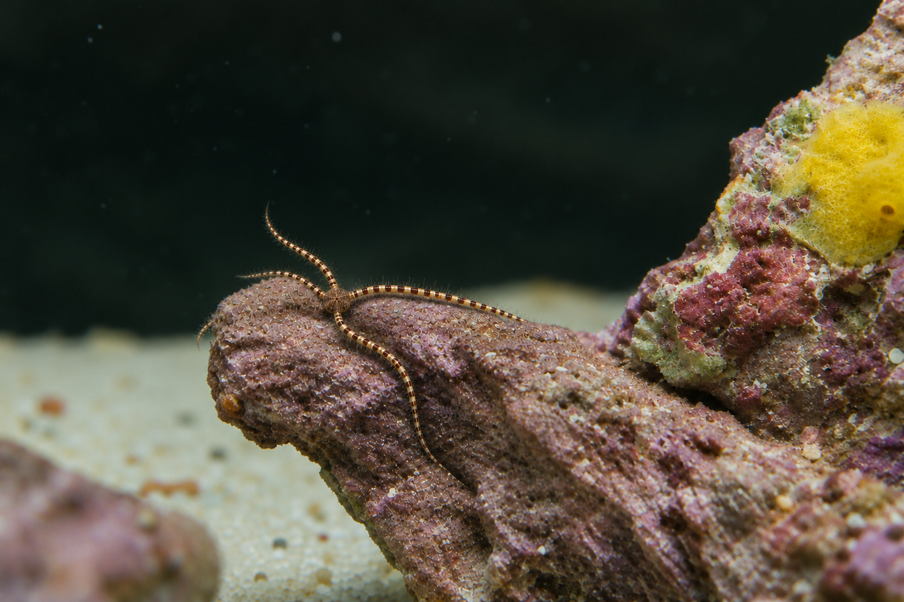

# liv-0004 — Ofelia

| Campo | Valor |
| --- | --- |
| Identificador | `liv-0004` |
| Tipo de unidad | Ejemplar |
| Nombre | Ofelia |
| Identificación | Microofiura (Ophiuroidea); *Ophiactis savignyi* muy probable según el propietario |
| Ubicación | Veril; llegó asociada a una roca viva |
| Estado registrado | Presencia observada el 19 de noviembre de 2026 |
| Registro de origen | [Operación del 19 de noviembre](../../../04_operaciones/2026/11/2026-11-19.md#primera-observación-confirmada-de-un-habitante) |

El 22 de noviembre de 2026, el propietario indicó que, con casi toda
seguridad, Ofelia es *Ophiactis savignyi*. La identificación se conserva
como muy probable.

## Imagen oficial

Reconstrucción fotorrealista basada en dos fotografías del 19 de noviembre
y en la observación del propietario. Se distingue el disco central y varios
brazos bandeados. La postura y la textura fina son aproximadas.
