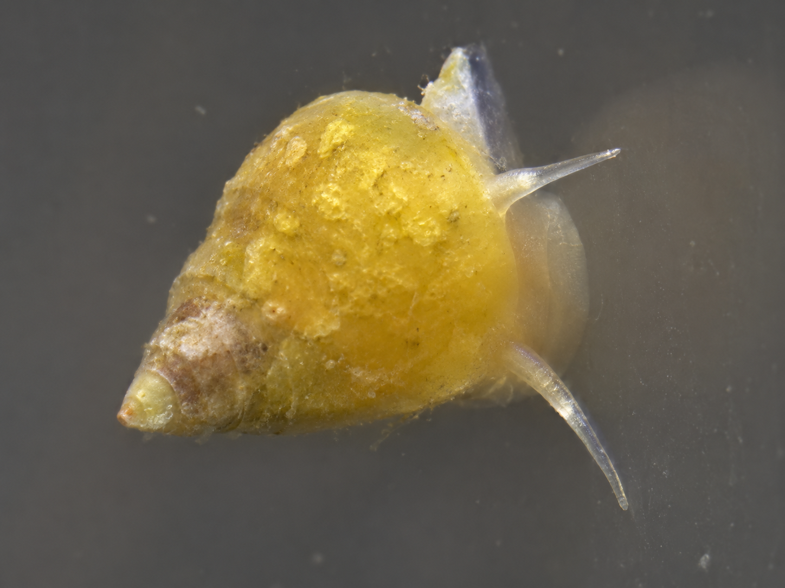

# liv-0005 — Stroll

| Campo | Valor |
| --- | --- |
| Identificador | `liv-0005` |
| Tipo de unidad | Ejemplar |
| Nombre | Stroll |
| Identificación | Caracol (Gastropoda); género sin determinar |
| Ubicación | Veril; observado en el cristal delantero |
| Estado registrado | Presencia observada el 19 de noviembre de 2026 |
| Registro de origen | [Observación del 19 de noviembre](../../../04_operaciones/2026/11/2026-11-19.md#observación-de-un-caracol) |

La identificación de género permanece abierta en el registro de la observación.

## Reconstrucción visual

Reconstrucción fotorrealista generada a partir de varias fotografías del
20 de noviembre. La silueta y el color se basan en las tomas. La textura fina
de la concha y los detalles del cuerpo son aproximaciones.
