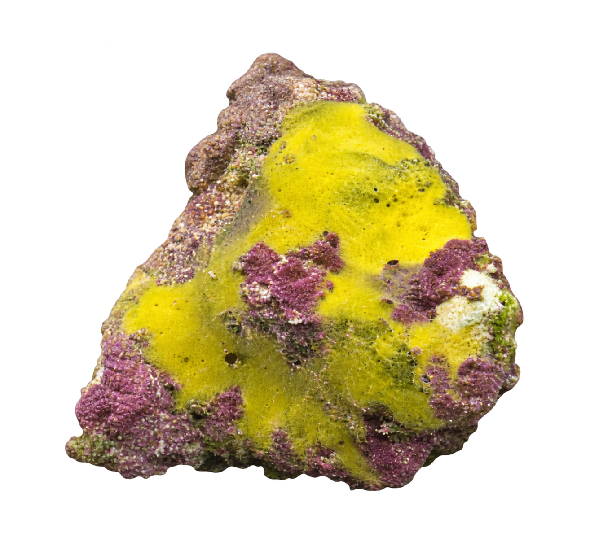

# liv-0008 — Esponjas de la roca viva

| Campo | Valor |
| --- | --- |
| Identificador | `liv-0008` |
| Tipo de unidad | Grupo asociado a una roca |
| Identificación | Esponjas (Porifera), sin determinar |
| Ficha general | [Esponjas](../../../01_verilpedia/02_biologia/05_invertebrados/06_filtradores/esponjas.md) |
| Ubicación | Veril, sobre la roca viva |
| Estado registrado | Presencia observada al incorporar la roca viva el 19 de noviembre de 2026 |
| Registro de origen | [Incorporación de roca viva](../../../04_operaciones/2026/11/2026-11-19.md#incorporación-de-roca-viva) |

## Fotografía

Vista editada a partir de una fotografía del 19 de noviembre de 2026.
La edición generativa aisló la roca y retiró el entorno y los reflejos.

