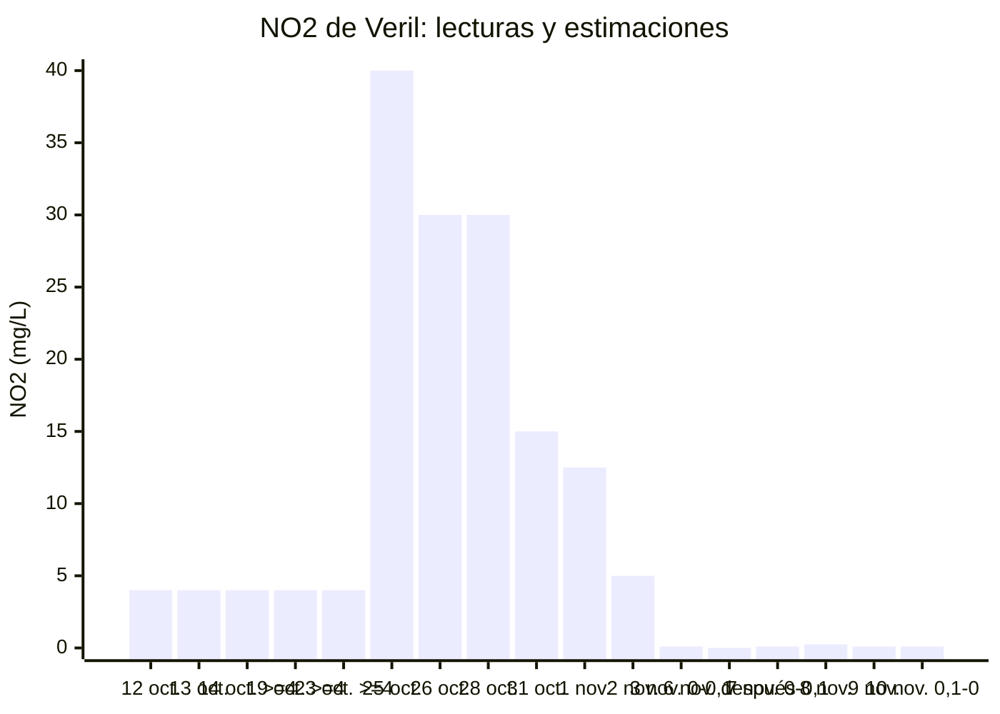
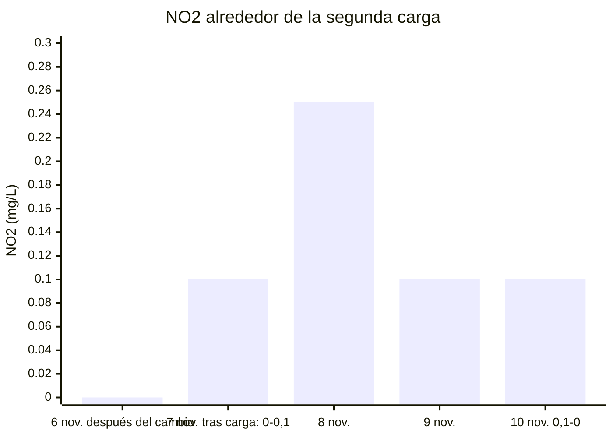

# Ciclado de Veril

## Seguimiento y resumen de mediciones

El ciclado está en seguimiento desde el **12 de octubre**. La arena ya está
incorporada y se han añadido la primera carga y la [segunda carga de Fishless
Fuel](../../04_operaciones/2026/11/2026-11-07.md#segunda-carga-de-fishless-fuel)
el 7 de noviembre; sigue el seguimiento de su respuesta.

La tabla reúne las lecturas desde el inicio. `—` indica que no hay lectura
registrada. Las columnas químicas corresponden a Salifert hasta el 9 de noviembre; el método de las lecturas del 10 no se ha especificado.

| Fecha y registro | Temperatura | Salinidad | Amonio / NH₃ (mg/L) | NO₂ (mg/L) | NO₃ (mg/L) | KH (dKH) / pH | Tetra 7in1: NO₃ / NO₂ (mg/L) | Tetra 7in1: GH / KH (°dH), pH, Cl₂ (mg/L) |
| --- | ---: | ---: | ---: | ---: | ---: | --- | --- | --- |
| [12 oct.](../../04_operaciones/2026/10/2026-10-12.md#incorporación-de-af-bio-sand) | 26,3; 26,4 (18:54) | 35,5 | <0,15; 0,25 (21:48) | 4; 4 (21:59) | — | 7,7 / — | 50 / 5 | 8 / 10 / 7,6 / 0 |
| [13 oct., 19:42](../../04_operaciones/2026/10/2026-10-13.md#medición-diaria-del-ciclado) | 27 | 35 | <0,15 | 4 | — | 8,9 / — | 50 / 10 | 8 / 10 / 8,0 / 0 |
| [14 oct.](../../04_operaciones/2026/10/2026-10-14-medicion-diaria-ciclado.md) | 27,1 | 35 | ≈0 | ≥4 | — | — / — | 100 / 10 | 8 / 10 / 7,2 / 0 |
| [15 oct.](../../04_operaciones/2026/10/2026-10-15.md#medición-diaria-del-ciclado) | 26,9 | — | 0 | ≥4 | — | — / — | 100 / 10 | 8 / 6 / 7,2 / 0 |
| [16 oct.](../../04_operaciones/2026/10/2026-10-16-medicion-diaria-ciclado.md) | 26,5 | 35 | 0 | ≥4 | — | — / — | 250 / 10 | 8 / 6 / 6,8 / 0 |
| [17 oct.](../../04_operaciones/2026/10/2026-10-17.md#medición-diaria-del-ciclado) | 27,2 | — | 0 | ≥4 | — | 7 / — | 250 / 10 | 8 / 6 / 6,8 / 0 |
| [19 oct., día 8](../../04_operaciones/2026/10/2026-10-19.md#tests-de-agua--día-8-del-ciclado) | 26,6 | 35 | 0 | ≥4 | ≥100 | 6,7 / 8,0–8,15 | 250 / 10 | 8 / 6 / 6,8 / 0 |
| [21 oct., 18:30](../../04_operaciones/2026/10/2026-10-21.md#mediciones-del-ciclado--1830) | 25,9 | 35 | 0 | ≥4 | ≥100 | 6,1 / 8,15 | 200 / 10 | 8 / 6 / 6,8 / 0 |
| [23 oct.](../../04_operaciones/2026/10/2026-10-23.md#medición-de-no₂) | — | — | — | ≥4 | — | — / — | — | — |
| [25 oct.](../../04_operaciones/2026/10/2026-10-25.md#repetición-del-test-de-no₂-con-dilución) | — | — | — | ≈40 | — | 6,1 / 8,15 | — | — |
| [26 oct.](../../04_operaciones/2026/10/2026-10-26.md#repetición-del-test-de-no₂-con-dilución) | — | — | — | ≈30 | — | — / — | — | — |
| [28 oct.](../../04_operaciones/2026/10/2026-10-28.md#nueva-medición-de-no₂-con-dilución) | — | — | — | ≈30 | — | — / — | — | — |
| [31 oct.](../../04_operaciones/2026/10/2026-10-31.md#medición-de-no₂-con-salifert-y-diluciones) | 26,6 | ≈35,5 | — | ≈15 | — | — / — | — | — |
| [1 nov.](../../04_operaciones/2026/11/2026-11-01.md#medición-de-no₂-con-diluciones) | 26,6 | — | — | ≈12,5 | — | — / — | — | — |
| [2 nov.](../../04_operaciones/2026/11/2026-11-02.md#medición-de-no₂-con-diluciones) | 26 | — | — | ≈5 | — | — / — | — | — |
| [3 nov.](../../04_operaciones/2026/11/2026-11-03.md#medición-de-no₂) | 26,2 | 35,5 | 0 | 0–0,1 | 50 | 5,4 / 8 | — | — |
| [6 nov., antes del cambio](../../04_operaciones/2026/11/2026-11-06.md#mediciones-de-agua-antes-del-cambio) | 26,6 | 35 | 0–<0,15, más cerca de 0 | 0–0,1, más cerca de 0 | 50 | 5,7 / 8,0 | 1 / 0 | 8 / 6 / 7,6 / 0 |
| [6 nov., después del cambio](../../04_operaciones/2026/11/2026-11-06.md#mediciones-de-agua-después-del-cambio) | 26,3 | 35 | 0 | 0 | 25–50 | 5,7 / 8,15–8,3 | — | — |
| [7 nov., antes de la carga](../../04_operaciones/2026/11/2026-11-07.md#mediciones-de-agua-antes-de-la-carga) | 26,6 | 35 | 0–<0,15 | 0–0,1, más cerca de 0 | 25–50 | 5,7 / 8,15 | — | — |
| [7 nov., después de la carga](../../04_operaciones/2026/11/2026-11-07.md#mediciones-después-de-la-carga) | — | — | 0–<0,15; <0,15 en repetición | 0–0,1 | — | — / — | — | — |
| [8 nov.](../../04_operaciones/2026/11/2026-11-08.md#mediciones-de-agua) | 26,1 | 35 | >0,15 | 0,25 | — | 5,7 / 8 | — | — |
| [9 nov.](../../04_operaciones/2026/11/2026-11-09.md#mediciones-de-agua) | 26,6 | 35 | 0,25 | 0,1 | — | 5,4 / 8 | — | — |
| [10 nov.](../../04_operaciones/2026/11/2026-11-10.md#mediciones-de-agua) | 26,4 | — | 0 | 0,1–0 | 50 | 5,1 / 8 | — | — |

Los valores de NO₂ del 25 de octubre al 2 de noviembre son estimaciones obtenidas
mediante diluciones; las lecturas originales figuran en cada registro. La
medición del 3 de noviembre se realizó sin diluir.
La lectura de NO₃ Tetra del 6 de noviembre se conserva como fue comunicada.
Las dos rondas del 6 de noviembre se tomaron antes y después del [cambio de
16,5 L](../../04_operaciones/2026/11/2026-11-06.md#cambio-de-agua), respectivamente.

El [25 de octubre](../../04_operaciones/2026/10/2026-10-25.md#corrección-del-método-de-medición-de-alcalinidad), el propietario comunicó que las mediciones anteriores de alcalinidad con Salifert se habían realizado incorrectamente. Se conservan como histórico; la lectura de ese día con el método correcto fue **6,1 dKH**.

El seguimiento documentado **no acredita todavía el cierre del ciclado**. La
respuesta a la segunda carga se seguirá conforme al [plan](01_plan.md).

## Gráfica aproximada del ciclado

Las barras resumen las lecturas de nitrito; la tabla anterior conserva los rangos,
métodos y registros originales. Cada fecha ocupa el mismo espacio en el eje,
aunque entre mediciones hayan transcurrido distintos números de días. No se
rellenan los días sin medición ni se proyecta una fecha de llegada a cero.

### Nitrito: acumulación y descenso

Las barras de las lecturas **≥4** solo representan el límite inferior conocido:
no demuestran que el nitrito permaneciera en 4 ni que subiera de 4 a 40 el
25 de octubre. Los valores del 25 de octubre al 2 de noviembre son aproximaciones
por dilución. Para las lecturas **0–0,1** y **0,1–0** se dibuja el extremo superior, 0,1,
únicamente para visualizar el intervalo; no es una lectura exacta.

### Detalle de la respuesta a la segunda carga

La segunda carga fue de **2 ml de Fishless Fuel el 7 de noviembre a las
18:04 WET**. Esta ampliación permite ver las pequeñas lecturas de nitrito
que quedan comprimidas en la escala anterior.

El **amonio total** no se dibuja como una curva continua: hay días sin medición,
categorías **<0,15** y una lectura **>0,15** el 8 de noviembre que no permite
asignar un valor exacto. Tras la primera carga se registró **0,25 mg/L el
12 de octubre** y lecturas de **0** en rondas posteriores. Después de la segunda
carga, la lectura fue **<0,15** en la repetición del 7, **>0,15** el 8 y
**0,25 mg/L** el 9 y el propietario comunicó **NH₃ 0** el 10. Estos datos no permiten reconstruir un pico ni dar por
procesada la segunda carga. El nitrato se mantiene en la tabla, con sus rangos.

## Qué consultar

- [Plan](01_plan.md): condiciones y criterios de la prueba que sigue pendiente de cerrar.
- [Procedimiento de seguimiento](02_runbook.md): mediciones y pasos restantes.
- [Receta adoptada](decisiones/01_seleccion-inoculante-y-receta.md): componentes y cálculo de dosis.
- [Antecedente de Elite Reef](decisiones/02_referencia-elite-reef-e-inoculacion-previa.md): consejo del 9 de octubre y evolución posterior.
- [Proyección microbiológica](03_proyeccion-microbiologica.md): alcance funcional esperado de los medios utilizados.

La explicación general está en [ciclado sin peces](../../01_verilpedia/06_procesos/02_ciclado-sin-peces.md).
La fase posterior tiene su propio [plan de maduración](../maduracion/01_plan.md).
