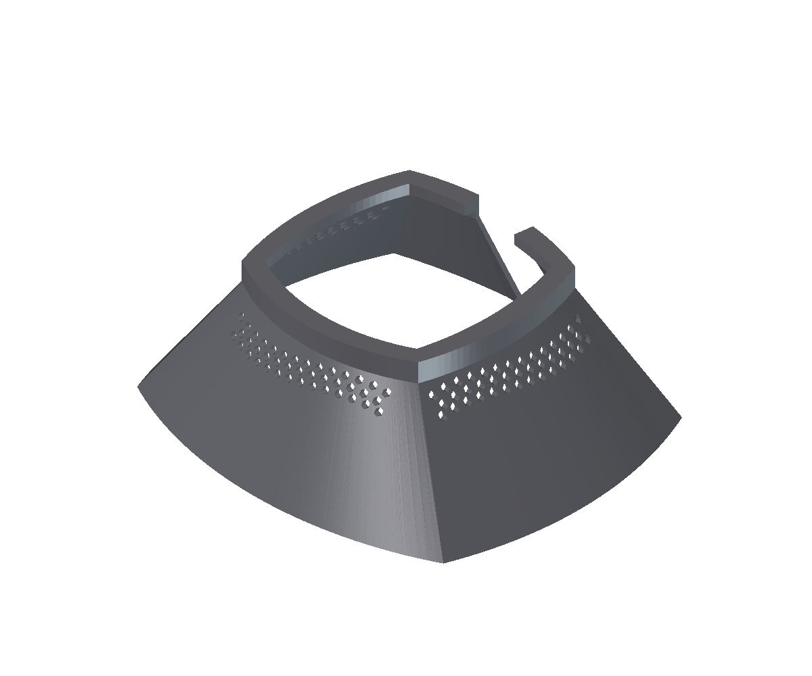

# Pantalla para AI Prime 16HD

Pantalla exterior de una pieza, con collar corto de apoyo y falda inclinada
hacia fuera, destinada a limitar la luz lateral de la luminaria.
Conserva **123 aberturas de ventilación** y la abertura posterior.
El ajuste físico, la refrigeración y la reducción del deslumbramiento
siguen pendientes de validación en el montaje real.



## Archivos

- [FreeCAD completo y editable](ai-16-shade.FCStd): referencias originales, operaciones, parámetros y malla final guardada
- [Modelo 3MF neutro](ai-16-shade.3mf): una pieza completa, a escala 1:1 y en milímetros, de **228,762 × 199,129 × 80 mm**

El 3MF contiene sólo geometría y unidades, sin perfiles de impresora,
material, trayectorias ni miniaturas. El collar superior está apoyado sobre Z=0 y la falda se abre hacia arriba.
Así el labio interior de apoyo nace sobre la cama y evita el voladizo que
aparecería imprimiendo con la boca ancha abajo.
Requiere una cama que admita esa huella y el margen de adhesión necesario;
no es una versión dividida para impresoras pequeñas. Revisar pendientes,
ventanas y apoyos en el laminador antes de imprimir. Otras orientaciones
pueden mejorar la resistencia o el acabado, pero requieren su propia revisión.

## Parámetros del FreeCAD

Seleccionar **ÁNGULOS — modificar estos dos valores** (`Angulos`)
y editar sus propiedades en la pestaña Datos.

| Propiedad | Valor de esta edición | Función |
| --- | --- | --- |
| `FrenteTrasera` | 26,7182790853° | Apertura frontal y trasera desde la vertical |
| `Laterales` | 35,5312970078° | Apertura lateral desde la vertical |
| `AlturaRecta` | 12 mm | Collar recto: 8 mm de apoyo y 4 mm de prolongación |
| `AlturaTotal` | 80 mm | Altura total de la pantalla |
| `EspesorPared` | 2,8 mm | Espesor nominal de la falda; varía localmente en las esquinas |

El frente está en Y negativo, la abertura posterior en Y positivo y los
laterales en X. Los ángulos positivos abren hacia fuera. Cambiar los ángulos
o la altura recta cambia la boca inferior. Mantener al menos los 8 mm del
apoyo al ajustar el collar. Recalcular y comprobar ventilación y encaje
tras cualquier cambio; regenerar el 3MF para actualizarlo.

### Recálculo de la malla final

La pieza final `ShadeFinal` es una **malla cerrada**, no un sólido BRep nativo.
El documento conserva sus operaciones intermedias y la geometría final,
que puede visualizarse y exportarse sin reconstruirla.

Para regenerar esa malla al modificar parámetros se necesita el módulo
`ai16shade_feature`, con **Manifold 3.5.4** y **NumPy** compatibles con el
Python y la plataforma de FreeCAD. El código completo del módulo está
incluido como texto en `ShadeFinal.CodigoRecalculo`; no depende de rutas
privadas ni contiene una biblioteca compilada para una máquina concreta.

<details>
<summary>Habilitar el recálculo en otro equipo</summary>

Con este documento activo, ejecutar en la consola Python de FreeCAD:

```python
from pathlib import Path
import FreeCAD as App
carpeta = Path(App.getUserAppDataDir()) / "Mod" / "VerilAI16Shade"
carpeta.mkdir(parents=True, exist_ok=True)
(carpeta / "ai16shade_feature.py").write_text(
    App.ActiveDocument.ShadeFinal.CodigoRecalculo, encoding="utf-8"
)
(carpeta / "Init.py").write_text("import ai16shade_feature\n", encoding="utf-8")
print("Dependencias en:", carpeta / "vendor")
```

Instalar `manifold3d==3.5.4` y `numpy` en la carpeta `vendor` indicada,
utilizando pip de un Python compatible con el de FreeCAD. Comprobar versión,
arquitectura y sistema; una instalación de otro Python no basta.
Reiniciar FreeCAD y reabrir el archivo antes de cambiar los parámetros.
Sin ese módulo, la malla guardada no debe darse por actualizada tras un cambio.

</details>

## Impresión y montaje

El **PETG** es un candidato por su tenacidad y resistencia a la humedad,
según la [guía de Prusa](https://help.prusa3d.com/article/petg_2059).
La temperatura real junto a la luminaria y la ficha técnica del filamento
concreto deben guiar la elección; el nombre del polímero no acredita su
comportamiento térmico en este montaje. Para limitar reflejos, valorar un
acabado opaco. La pieza se utiliza sobre la luminaria, fuera del agua.

Como punto de partida, capas de 0,16–0,20 mm y paredes continuas bien fusionadas,
resolviendo el espesor sin huecos entre líneas. Revisar especialmente el apoyo
y los contornos de ventilación. No aplicar una escala global para corregir un
encaje sin comprobar cómo afecta a todas las dimensiones.

Montar con la luminaria desconectada y fría, sin forzar ni cubrir sus entradas
o salidas de aire. Retirar rebabas e hilos de las 123 perforaciones y mantener
libre la abertura posterior. Comprobar sujeción, distancia al agua y ausencia
de deformación o calentamiento excesivo durante una prueba vigilada. Limpiar
salpicaduras y depósitos de sal sin introducir agua en la electrónica.

**Estado:** malla cerrada y geometría comprobadas digitalmente. Cobertura,
deslumbramiento, encaje y funcionamiento térmico pendientes de prueba física.

## Procedencia

Adaptación del archivo aportado `ai_prime_shade_erc_v5.3mf`. Sus metadatos
identifican a **tooALTtoCTRL** como redistribuidor y atribuyen el diseño original
a **ludnix**, autor del [modelo de Thingiverse](https://www.thingiverse.com/thing:3698357)
y de [su presentación original](https://www.reef2reef.com/threads/ai-prime-hd-light-shade.615720/).
El archivo redistribuido declara **CC0**; no se ha contrastado esa declaración
con la licencia de la publicación original. Se conservan ambas atribuciones
sin presentar el diseño de partida como creación de Veril ni asignarle una
licencia distinta por inferencia.
