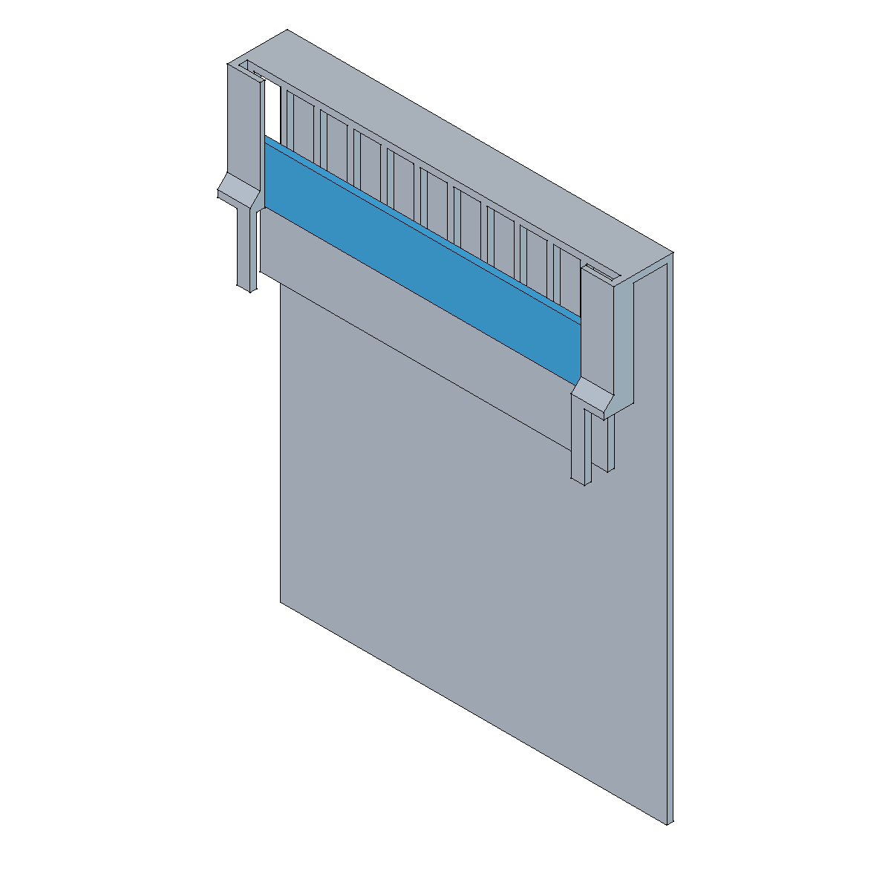

# Rebosadero regulable con pantalla posterior

Conjunto desmontable para un separador de sump de **6 mm**: una estructura
apoyada sobre el canto del vidrio y una placa intercambiable que eleva la
cresta de rebose. La pantalla posterior deja un canal de bajada despejado de
**12 mm**, accesible para limpieza.

Los colores del CAD distinguen la estructura y la placa; no prescriben el
color del filamento.

## Archivos

- [FreeCAD completo y editable](rebosadero.FCStd): los dos cuerpos montados, historial nativo y hoja de parámetros
- [Estructura del rebosadero](estructura.3mf): una pieza de **139,8 × 25,2 × 178,4 mm**, orientada para imprimir invertida
- [Placa reguladora de 20 mm](placa-20mm.3mf): una pieza de **134,4 × 20 × 2,4 mm**, con su cara ancha contra la cama

Los dos 3MF contienen exclusivamente geometría en milímetros, a escala 1:1,
con la base sobre Z=0. Cada archivo incluye una pieza. No llevan perfiles,
materiales, trayectorias, miniaturas ni datos de conexión. Cada usuario debe
laminarlos para su impresora; el montaje del FreeCAD no se imprime como un bloque.

## Dimensiones y ajuste

| Interfaz | Valor nominal |
| --- | --- |
| Ancho exterior de la estructura | 139,8 mm |
| Alojamiento del vidrio | 6 mm |
| Paredes y grosor de la placa | 2,4 mm |
| Rebaje lateral para silicona | 7 mm por extremo, bajo el canto |
| Canal posterior | 12 mm |
| Altura de la placa sobre el canto | 20 mm |
| Holgura lateral de placa | 0,3 mm por extremo |

La hoja **data** permite editar el ancho (B9), el rebaje de silicona (B16),
la altura de placa (B17) y su holgura lateral (B18). Recalcular y revisar
encajes y recorrido de la placa tras cualquier cambio; regenerar después
los 3MF, que no se actualizan automáticamente.

Comprobar las dimensiones reales del vidrio y los cordones de silicona antes
de imprimir. Las pinzas deben entrar sin forzar ni rozar la silicona.
Los 20 mm definen la altura geométrica de la cresta; el nivel real será
mayor y dependerá del caudal y de las fugas por las holguras.

## Impresión e inmersión marina

Como candidato, utilizar **PETG de composición conocida**, evitando cargas,
aditivos antimicrobianos y mezclas decorativas sin evaluación para este uso.
La [guía de Prusa sobre PETG](https://help.prusa3d.com/article/petg_2059)
describe su resistencia a la humedad y adhesión entre capas; estas propiedades
no certifican la inocuidad de una formulación concreta en un acuario marino.

Priorizar paredes continuas, bien fusionadas y sin huecos que comuniquen con
un relleno difícil de limpiar. Mejoran la resistencia y reducen la entrada de
agua y residuos al interior de la impresión. Como punto de partida con
boquilla de 0,4 mm, usar **4–6 perímetros** y capas de **0,16–0,20 mm**, resolviendo
las paredes de 2,4 mm y la placa con líneas contiguas y cierres completos.
Comprobar el grosor efectivo en la vista de capas: el número de perímetros
no aumenta el espesor del CAD. Los [ensayos de Prusa sobre estanqueidad](https://blog.prusa3d.com/watertight-3d-printing-pt1-vases-cups-and-other-open-models_48949/)
respaldan la importancia de los perímetros, pero ningún ajuste garantiza por
sí solo estanqueidad.

La orientación incluida responde a las limitaciones físicas de la impresora
del autor. El cuerpo invertido aprovecha los cierres inclinados para evitar
soportes; otras orientaciones pueden mejorar la resistencia y requieren
revisar puentes, apoyos y encajes. Comprobar la estabilidad de esta pieza alta
y estrecha. Si se utiliza brim, limitarlo al exterior, dejando libres las
ranuras y el canal. Los modelos no incorporan soportes ni aletas temporales.

## Montaje y mantenimiento

Retirar rebabas e hilos, lavar con agua y cepillo suave y enjuagar bien antes
del uso. Rechazar piezas con grietas, delaminación o desprendimientos.
Asentar la estructura sobre el separador e introducir la placa en sus guías,
sin presión sobre el vidrio ni la silicona.

Comprobar niveles, margen al borde, caudal, fugas laterales y extracción de la
placa con el sistema funcionando. Verificar también parada y rearranque de la
bomba. Mantener libres las aberturas y el canal; retirar depósitos durante el
mantenimiento. La pantalla no tiene eficacia demostrada como eliminador de
microburbujas.

**Estado:** geometría CAD comprobada y mallas cerradas. Las probetas de ancho
y del rebaje de silicona han encajado en el punto ensayado; el montaje completo,
el deslizamiento de la placa y el comportamiento hidráulico siguen pendientes
de validación física.
