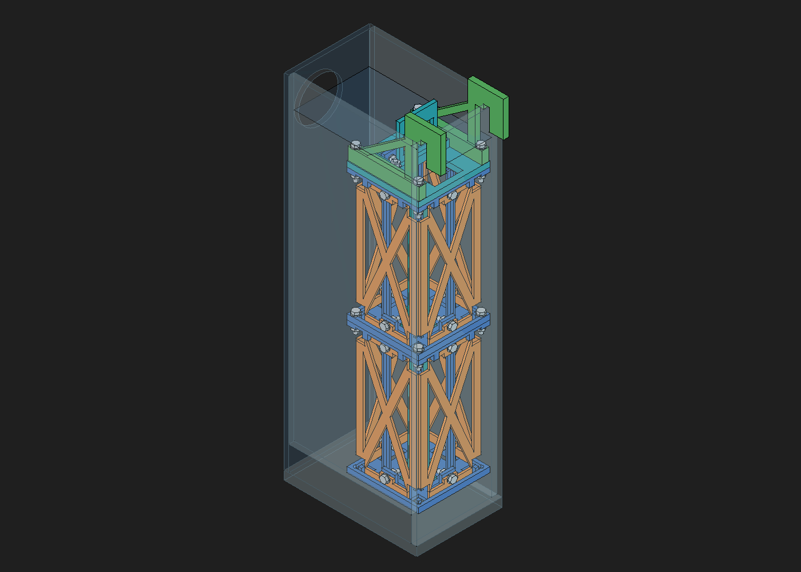
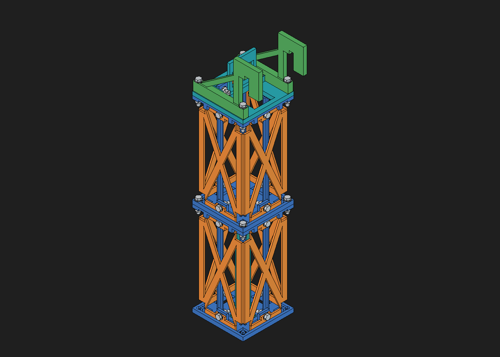

# Biobolas: bastidor simplificado con tornillería M4

Diseño candidato del 12 de octubre de 2026. El propietario autoriza tornillería
comercial de plástico. La fuente es [soporte-biobolas-atornillado.FCStd](soporte-biobolas-atornillado.FCStd).
Se conserva el [bastidor anterior](../soporte-biobolas-bastidor/README.md) sin
modificar su CAD. Los G-code anteriores no corresponden a este nuevo diseño.

## Restricciones y simplificación

Se mantienen PETG, impresión FDM en 180 × 180 × 180 mm, inmersión en agua salada,
40 biobolas en dos módulos de 20, dos hoteles y apilado con paso de 150 mm.
La masa aproximada comunicada de bolas mojadas y hoteles es 1,2 kg. La referencia
de carga del conjunto se mantiene en 2 kg, incluyendo estructura, tornillería
y agua retenida. No se ha medido la masa final ni ensayado este diseño. El volumen de las
16 piezas equivale a 311,5 g de PETG macizo a 1,23 g/cm³, un 33,8 % menos
que los 470,7 g del CAD anterior. Es una comparación geométrica, no consumo
de laminado. Se reservan provisionalmente 50 g para tornillería y 150 g para
agua retenida, resultando unos 1,71 kg antes del redondeo a 2 kg.

La revisión reduce las piezas impresas del conjunto de **100 a 16** y las
uniones desmontables de 42 a **26**, sustituyendo pasadores y chavetas por
M4 pasantes con tuerca. Hay seis geometrías maestras de fabricación. Se usa
un único panel de 2,4 mm en las ocho caras, sin patrones A/B ni nervio central
hasta 5,2 mm. Las guías centrales de biobolas, que se imprimieron bien en v1,
se conservan en la base. Los laterales se imprimen planos.

Cada panel lleva un tornillo en cada extremo, en el centro de su travesaño.
Los alojamientos inferiores y las guías exteriores superiores limitan giro
junto con los apoyos y el tornillo. El cierre transmite tracción/cortadura al
levantar la torre. No se atribuye esa retención a una ranura abierta ni solo al
rozamiento por apriete. Esto cambia la propuesta conceptual de concentrar todos
los cierres en las esquinas: el CAD usa dos cierres por cara y reserva las
cuatro esquinas para el apilado y la suspensión, facilitando el acceso.

Los módulos ocupan 81 × 81 mm, con centro X=29 mm, Y=0. La base inferior está
en Z=25 mm y la superior en Z=175 mm. Las bolas conservan Ø31 mm, altura 29 mm
y paso horizontal 36,5 mm. C1 y ambos conjuntos de bolas se copiaron; las bolas
conservan Sketcher/Revolution y arrays nativos, sin enlaces a otro documento.
Los hoteles conservan la geometría importada de la pieza anterior y se declaran
como referencias. Las holguras siguen siendo candidatas, no calibradas.

## Tornillería elegida y compra en Canarias

La solución comercial de referencia es **nylon/poliamida M4 de Fijaciones
Canarias**, Morro Tabares S.L. Su [catálogo de julio de 2025, página impresa 272](https://fijacionescanarias.com/wp-content/uploads/2025/08/baja_catalogo-2025_FEBRERO-2025-1.pdf)
incluye las longitudes y las tuercas/arandelas utilizadas. La
[política de envíos](https://fijacionescanarias.com/politica-de-envios/)
contempla Tenerife y las demás islas. El coste depende del código postal;
publica envío gratuito desde 40 € en Tenerife y 80 € en el resto de Canarias.

| Referencia | Uso | Cantidad |
| --- | --- | --- |
| M4×15, nylon hexagonal DIN 34810 / similar a DIN 933 | Paneles, dos por cara | 16 |
| M4×20, misma familia | Cuatro esquinas de apilado y dos fijaciones del asa | 6 |
| M4×35, misma familia | Marco superior + tapa + pie de escuadra, cuatro esquinas | 4 |
| 934N-4, tuerca hexagonal de nylon M4 | Una por tornillo | 26 |
| 125N-4, arandela de nylon M4 | Bajo cabeza y tuerca | 52 |

El catálogo declara tuerca de 7 mm entre caras y 3,2 mm de altura, y arandela
Ø4,3/9 × 0,8 mm. El CAD emplea cabeza hexagonal nominal de 7 mm entre caras y
2,8 mm de altura, que debe contrastarse con el producto entregado. Se comprueban
cabeza, tuerca y extremos de tornillo como envolventes; las roscas no se modelan.
Los objetos comerciales no son piezas para imprimir.

**Se ha verificado presencia en catálogo y venta/envío en Canarias, no
existencias ni precio de estas referencias.** No se ha hecho pedido ni enviado
consulta al proveedor. Antes de comprar deben confirmarse precio, unidades por
paquete, stock, dimensiones de cabeza, grado de poliamida y datos de carga en
húmedo. El catálogo no acredita aptitud para un acuario ni resistencia a largo
plazo sumergida. BAUHAUS se descartó porque sus condiciones excluyen Canarias.
La extracción local y sus límites están en [fuentes/tornilleria.json](fuentes/tornilleria.json)
y el [extracto del catálogo](fuentes/catalogo-nylon-p273.pdf).

## Piezas, orientación y montaje

| Maestra PETG | Unidades | Orientación prevista |
| --- | --- | --- |
| Base con cuatro guías centrales | 2 | Base en la cama, guías verticales, como en v1 |
| Panel X único de 2,4 mm | 8 | Plano XY, apoyado completamente |
| Marco superior de aro de 3 mm y refuerzo local | 2 | Invertido, apoyando su cara superior |
| Tapa abierta de 6 mm y travesaños de 20 mm | 1 | Plana |
| Escuadra de 6 mm, pie local de 8 mm | 2 | De lado, plana |
| Asa de 4 mm, pie local de 8 mm | 1 | Plana, refuerzo del pie hacia arriba |

La pared y el puente de silla conservan 16 mm de anchura por el momento del
gancho, mientras su espesor baja de 8 a 6 mm. La apertura sobre vidrio nominal
de 6 mm es 6,5 mm. No se interpreta ese margen como ajuste físico confirmado.
El asa tiene 62 × 48 mm, y el plano del agarre queda 2 mm desplazado respecto al
centro X de sus pies para permitir impresión plana sin apoyos elevados.

Montar paneles con los módulos apoyados, arandelas bajo cabeza/tuerca y acceso
al interior antes de introducir bolas y hoteles. Los tornillos laterales se
introducen desde fuera. Las uniones de apilado y escuadras se introducen desde
arriba. **Los dos tornillos del asa se introducen desde debajo de la tapa y
sus tuercas quedan encima del pie del asa**, dentro de los pasos de acceso.
Esta orientación evita cruzarse con la tornillería superior de los paneles.
Montar el asa en la tapa separada de la torre. No roscar directamente en PETG.

Las protrusiones nominales más allá de la tuerca son 4,4 mm en paneles, 4,2 mm
en apilado, 5,2 mm en suspensión y 1,2 mm en asa. Esta última es la longitud
más ajustada y exige medir la tornillería y confirmar el roscado completo.
No hay un par de apriete calificado: no usar un atornillador para imponer
un apriete arbitrario ni deformar PETG al bloquear una tuerca.

Cada maestra cabe individualmente en 180 mm. La orientación pretende evitar
soportes, con puentes locales de 4,4 mm en taladros horizontales. **Este diseño
no se ha laminado**: todavía no hay 3MF de Orca ni G-code nuevos, y la ausencia
de soportes generados no se ha verificado con el laminador.

## Comprobaciones y límites mecánicos

[comprobacion-cad.json](comprobacion-cad.json) registra sólidos, sketches,
interferencias con piezas, tornillería, envolventes anulares conservadoras de
las bolas, hoteles y vidrios visibles de C1. Se conservan dos arrays de 20
bolas con volumen equivalente al original. La reapertura con el documento
anterior cerrado conserva ambas matrices, todos los sketches restringidos
y ningún objeto inválido. Solo queda abierto el nuevo documento en FreeCAD. Las 540 comprobaciones no detectan solapes. Los 67 sketches existentes están
restringidos, y cuatro probetas están separadas de la lista de producción.
El ensayo de cambio de panel de 2,4 a 2,5 mm da un sólido válido y recupera
el volumen original al restaurar 2,4 mm. La comprobación geométrica no
acredita acceso de una herramienta, resistencia, fluencia ni calidad FDM.

[calculo-mecanico.json](calculo-mecanico.json) separa demandas y cribado
analítico de una aceptación. Se adopta 49,05 N verticales con multiplicador
2,5, dos conexiones efectivas y 10 N laterales. Los parámetros de PETG son
hipótesis, no mediciones. La flexión del tornillo en las uniones solapadas es
un caso crítico específico, que no puede aprobarse solo por su cortadura.
Un cribado conservador de la excentricidad del solape da unos 24,2 MPa de
flexión nominal en la raíz M4, frente a 3,16 MPa nominales de cortadura o
tracción. Este resultado no se compara con un admisible húmedo, que no está
publicado para la referencia. **La unión M4 no queda aceptada mecánicamente**:
se debe confirmar con datos del proveedor y las probetas, o modificar el
apoyo si no supera el ensayo. Este es el límite mecánico prioritario antes de
fabricar la torre completa. La resistencia húmeda del nylon y el
apriete/fluencia siguen sin calificar.

Las diagonales finas se estudian con la rama a tracción para cada sentido de
carga lateral. No se les atribuye automáticamente capacidad a compresión.
Ni la geometría ni el cálculo acreditan la resistencia del vidrio.

Hay cuatro [muestras de encaje y carga](modelos/) en el CAD, separadas de las
16 piezas del conjunto: apoyo de panel, lengüeta con el borde crítico y dos
placas de esquina equivalentes al apilado. Antes del conjunto deben confirmar
paso de M4, puente horizontal, acceso, retención y sección próxima al taladro.
Ensayar cada unión con 2,5 kg durante 10 min en un útil representativo, descargar
y rechazar grietas o deformación residual mayor de 0,2 mm. Repetir tras 48 h
en agua salada y diez montajes. Confirmar que las tuercas no se aflojan.

Después comprobar ambos órdenes de apilado, carga de servicio de 2 kg,
100 elevaciones, 10 N laterales y sobrecarga de 5 kg durante 10 min fuera del
acuario, en un útil rígido. La carga de los asientos se ensaya aparte, sin
poner los 5 kg sobre las bolas. Registrar deformación bajo 2 kg a 24 h y a
0, 1, 7, 14 y 30 días de inmersión. Los criterios detallados del
[protocolo anterior](../soporte-biobolas-bastidor/validacion-fisica.md) siguen
siendo referencia para cargas, recuperación y seguimiento, sustituyendo las
pruebas de chavetas por las de tornillo, tuerca y retención de apriete.

## Fuente y derivados

El FCStd es la fuente. [crear-cad.py](crear-cad.py) conserva la construcción
nativa por bloques y [validar-cad.py](validar-cad.py) las comprobaciones.
No ejecutar la creación sobre un documento ya construido. Los STEP de
[modelos/](modelos/) son derivados en orientación de fabricación. Las vistas
son capturas del CAD, no ilustraciones que sustituyan geometría real.

