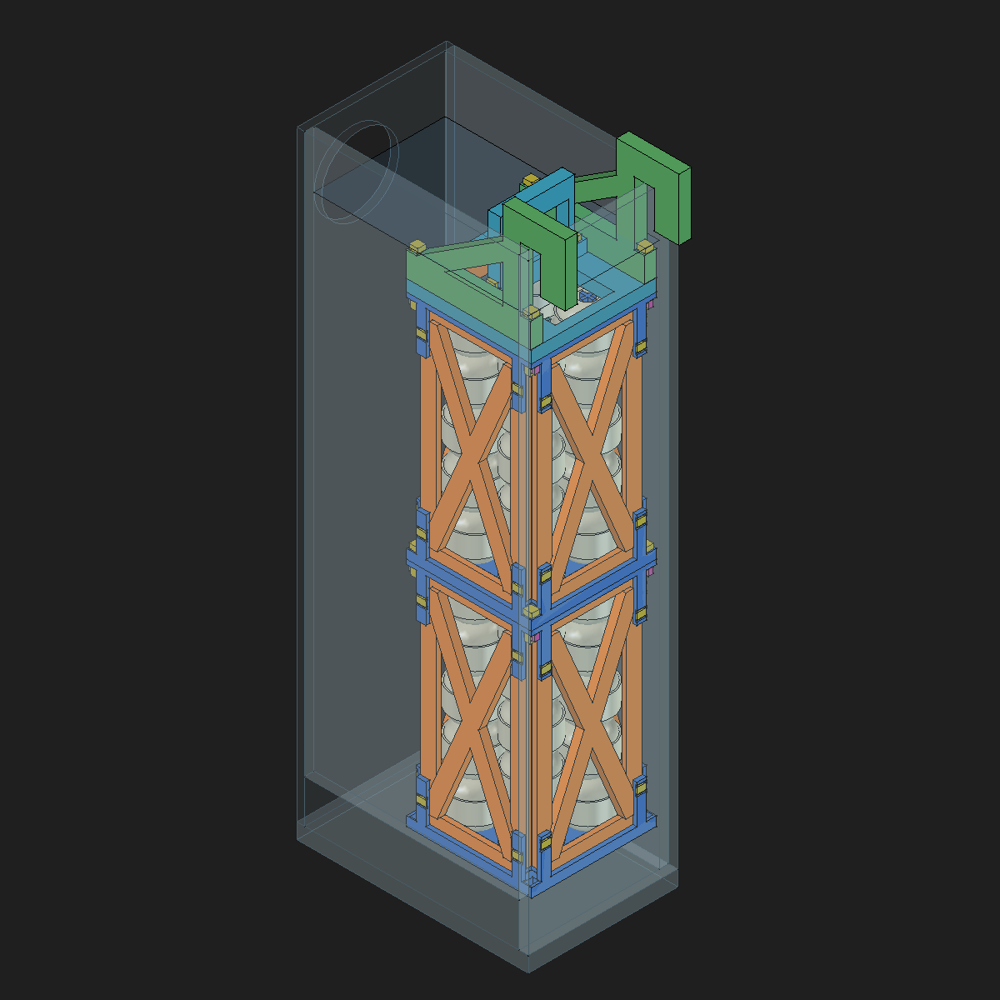
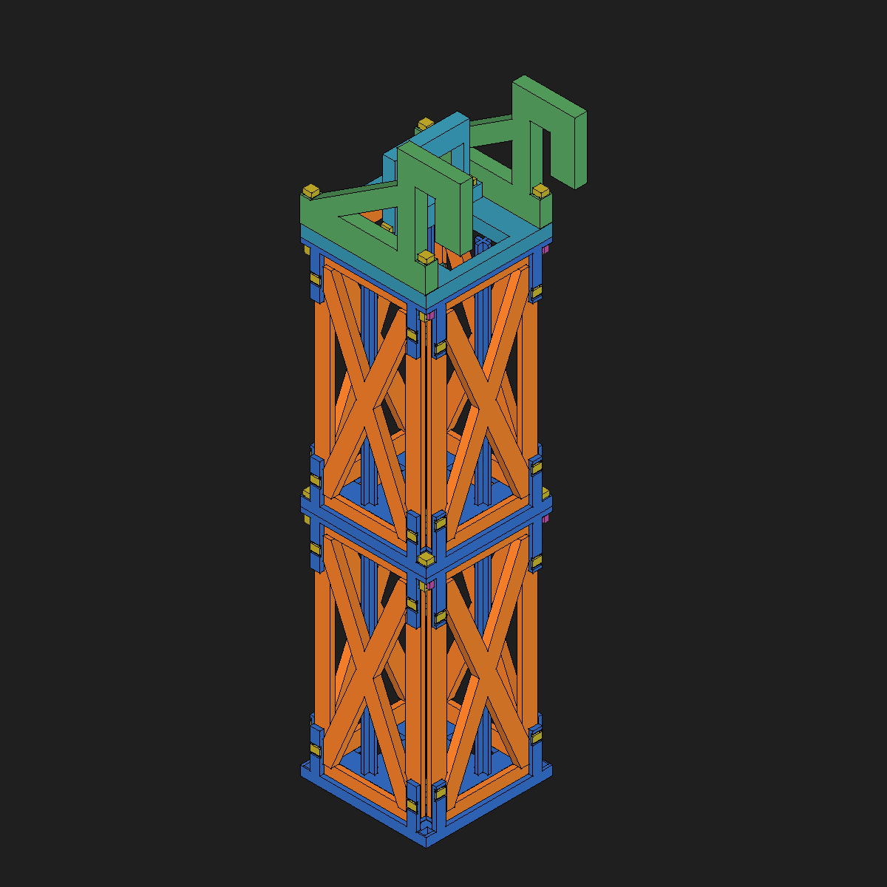

# Soporte de biobolas: bastidor triangulado

La nueva iteración está en [bastidor simplificado con tornillería M4](../soporte-biobolas-atornillado/README.md). Este documento y sus archivos conservan el antecedente de pasadores y chavetas.

Revisión funcional del 12 de octubre de 2026. **CAD completado para prototipo
y fabricación digital preparada; pendiente de ensayos físicos.** La decisión
selecciona dos módulos idénticos, cuatro caras con diagonales cruzadas por
módulo, base reforzada y suspensión dividida en piezas imprimibles acostadas.
Los antecedentes se conservan en [Soporte Biobolas](../soporte-biobolas.md).

Fuente editable: [soporte-biobolas-bastidor.FCStd](soporte-biobolas-bastidor.FCStd).
C1, Conjunto Biobolas y las 20 bolas auxiliares del módulo superior están
copiados con sus dependencias nativas. Los dos hoteles son referencias de la
geometría anterior, que no se rediseña. Solo queda abierto este documento de
FreeCAD. El CAD inicial se conserva oculto como antecedente y se mantuvieron
copias de seguridad antes de intervenir; los originales anteriores conservan
su geometría.

## Revisión de simplificación solicitada

El 12 de octubre de 2026 el propietario cuestiona el sistema de pasadores y
el exceso de material y acepta tornillería comercial de plástico. Se adopta
como dirección de rediseño eliminar los 42 pasadores y sus 42 chavetas.
El CAD y los diez G-code descritos más abajo corresponden todavía al bastidor
anterior y se conservan como antecedente. No son archivos de la alternativa
simplificada. La recomendación de imprimir sus probetas queda suspendida
mientras se desarrolla la nueva unión.

El diagnóstico de diseño es la cantidad de cierres, su acceso y la dependencia
de pequeños seguros sometidos a carga. No hay un ensayo que demuestre la rotura
de esos pasadores. Tampoco se ha demostrado que todos los espesores actuales
sean innecesarios: la suspensión tiene un brazo de palanca y los asientos
reciben cargas localizadas.

La propuesta mantiene las dos bases, cuatro caras abiertas por módulo y
apilamiento de paso 150 mm. Las caras se imprimen planas. Los extremos de los
paneles deben quedar atrapados mecánicamente en base y marco, mediante pestañas
ensanchadas y apoyos amplios. Una ranura recta abierta no garantiza que el módulo
inferior quede colgado al elevar la torre. Los alojamientos deben guiar y
transmitir esfuerzos por contacto, sin depender exclusivamente del rozamiento
de un tornillo apretado. La tornillería bloquea la vía de desmontaje y las
uniones entre módulos y suspensión reciben además la tracción correspondiente.

Se busca concentrar los cierres en las esquinas y evitar tornillos individuales
para cada extremo de diagonal. Aún debe resolverse la geometría que capture dos
caras adyacentes y permita montarlas y desmontarlas: no se da por lograda una
cantidad concreta de tornillos antes de comprobar esa unión.

| Elemento | Dirección de simplificación | Condición que debe comprobarse |
| --- | --- | --- |
| Caras | Estudiar 2,4 mm planos, sin el refuerzo continuo hasta 5,2 mm | Tracción, holguras y rigidez del módulo, con X en ambos sentidos |
| Esquinas | Refuerzo local y uniones accesibles | Retención positiva de paneles y acceso a tuerca y herramienta |
| Base | Conservar material en asientos y nervios locales | Los rebajes del hotel no deben debilitar el asiento |
| Apilamiento | Apoyo guiado y tornillos pasantes de plástico | Bloqueo de separación al levantar ambos módulos |
| Tapa y suspensión | Eliminar alojamientos de llaves y unir directamente las piezas | Revisar momento sobre el gancho, apoyos y sección alrededor de taladros |
| Tornillería | Una familia métrica como objetivo, sin roscar directamente en PETG | Material, longitud, carga admisible, cabeza y tuerca del producto concreto |

Los 2,4 mm son una dimensión de estudio, no un espesor validado. Como comprobación
preliminar, con E supuesto de 600 MPa, una diagonal uniforme de 8 × 2,4 mm y
148,85 mm entre apoyos tendría carga crítica ideal articulada de unos 2,46 N.
La demanda lateral del cálculo anterior es 12,79 N por diagonal. Por tanto,
no sirve adelgazarla y mantener la hipótesis de trabajo a compresión.
A tracción la misma sección tendría tensión nominal de 0,67 MPa y alargamiento
axial ideal de 0,165 mm bajo esa fuerza. Eso permite estudiar una X con una rama
principalmente a tracción para cada sentido, pero no acredita rigidez de las
uniones, fluencia o comportamiento de la otra rama.

La siguiente pieza a desarrollar es una muestra de esquina con captura de
panel y tornillo/tuerca accesibles. Primero debe resolver carga de extracción,
giro, montaje, retención húmeda e impresión sin soportes. Después se podrá
extender al módulo y recalcular suspensión, masa y número de piezas. Se mantienen
PETG, impresión de 180 × 180 × 180 mm, inmersión salada, las 40 biobolas y los
dos hoteles de aproximadamente 1,2 kg, con 2 kg de servicio como referencia
provisional del conjunto. Esta revisión es una propuesta mecánica documentada,
no un CAD simplificado ni un laminado nuevo.

## Restricciones y decisiones

| Restricción | Aplicación |
| --- | --- |
| FDM, PETG y 180 × 180 × 180 mm | Cada pieza cabe por separado, incluido el brim de su receta; no se imprime la torre montada |
| Módulos apilables e intercambiables | Dos módulos iguales de 20 bolas, paso vertical de 150 mm; cuatro llaves bloquean su separación |
| Capacidad y referencia | Cuatro columnas de cinco bolas por módulo; Ø31 mm, altura 29 mm y paso lateral 36,5 mm conservados |
| Espacio de C1 | Módulos 81 × 81 mm; centro X 29, Y 0; base inferior Z 25; bolas inferiores Z 28–173 y superiores Z 178–323 |
| Tapa y suspensión | Marco abierto con travesaños para el asa, dos escuadras trianguladas, contacto con vidrio nominal 6 mm y apertura 6,5 mm, sin almohadillas |
| Soportes | Todas las recetas tienen soportes desactivados; piezas planas y ventanas pequeñas comprobables en probetas |
| Agua salada y flexibilidad | No se confía en presillas portantes ni en una sola diagonal; quedan pruebas específicas de rigidez, retención y fluencia |

La envolvente del conjunto con suspensión es 103,25 × 81,8 × 381 mm, desde
Z 25 hasta 406. El mayor ancho corresponde a la silla exterior sobre el vidrio;
los módulos mantienen 81 × 81 mm. Los márgenes nominales y las intersecciones
no equivalen a un ajuste físico: la base llega al plano interior del vidrio
derecho en el CAD original. Se debe comprobar la entrada real con las piezas
impresas.

## Estructura y cierres

La base conserva los asientos a 3 mm para no elevar las bolas ni el hotel,
refuerza el aro a 6 mm y ensancha los nervios a 12 mm. Los rebajes para los pies
del hotel dejan 7,1 mm de nervio en la sección local más estrecha. Mantiene
los cuatro mástiles cruzados que se imprimieron bien en v1.

Cada módulo lleva dos paneles A y dos B. Los marcos tienen 10 mm de anchura,
las diagonales cruzadas 10 mm y el panel base 3,2 mm. Los nervios de las
diagonales aumentan localmente el espesor a 5,2 mm hacia el exterior, evitando
invadir las bolas. Los patrones A/B escalonan la altura de los pasadores para
que los seguros de caras adyacentes no se crucen.

Cada panel se guía en los alojamientos de base y marco superior y se bloquea
con dos pasadores por extremo, en horquillas con dos orejetas. Los pasadores
rectangulares de 4 × 4 mm se imprimen planos y llevan punta estrechada y pared
de extremo de 0,9 mm. Una chaveta transversal impide su retirada axial.

Cuatro llaves de 3,6 × 5,2 mm conectan los dos módulos; otras cuatro fijan la
suspensión y dos el asa. Las chavetas estructurales tienen sección 3 × 4 mm y
se dimensionan también a flexión, porque forman parte del camino de carga.
Las cabezas y chavetas bloquean la separación; el apoyo plano transmite
compresión y los alojamientos limitan desplazamiento lateral. **La retención
frente a migración de las chavetas sigue siendo candidata:** se debe rechazar
un cierre que se afloje tras mojarlo, invertirlo o repetir su montaje.

La tapa se divide en marco, dos escuadras trianguladas y asa centrada. Las
escuadras se imprimen de lado, con 8 mm de espesor y pared y puente de silla
de 16 mm. El asa tiene 64 mm de anchura nominal, 48 de altura y 8 de espesor;
sus llaves apoyan en dos travesaños interiores, separados de las escuadras.
Los pasos en escuadras y asa permiten introducir las llaves sin atravesar una
pared cerrada. El hotel se extrae con la tapa retirada y el módulo apoyado.

## Piezas y fabricación

Los componentes se modelan mediante Body, Sketcher, Pad y Pocket nativos;
los sketches están completamente restringidos. `RevisionParameters` recoge
cotas y holguras candidatas. Las referencias importadas del hotel se declaran
como tales y conservan su procedencia.

| Pieza | Objeto maestro | Unidades totales | Dimensiones del maestro |
| --- | --- | --- | --- |
| Base y mástiles | `FunctionalBase` | 2 | 81 × 81 × 148 mm |
| Panel A | `PanelA` | 4 | 68.2 × 147 × 5.2 mm |
| Panel B | `PanelB` | 4 | 68.2 × 147 × 5.2 mm |
| Marco superior | `FunctionalUpper` | 2 | 81 × 81 × 31 mm |
| Tapa | `LidFrame` | 1 | 81 × 81 × 8 mm |
| Escuadra | `HangerPlate` | 2 | 103.25 × 73 × 8 mm |
| Asa | `CenteredHandle` | 1 | 64 × 48 × 8 mm |
| Pasador de panel | `PanelKey` | 32 | 6.2 × 11.1 × 4 mm |
| Chaveta de panel | `PanelKeeper` | 32 | 5.4 × 1.3 × 2.2 mm |
| Llave de apilamiento | `StackKey` | 4 | 5.6 × 17.6 × 5.2 mm |
| Llave de suspensión | `LidKey` | 4 | 5.6 × 35.6 × 5.2 mm |
| Llave del asa | `HandleKey` | 2 | 5.6 × 24.6 × 5.2 mm |
| Chaveta estructural | `StructuralKeeper` | 10 | 6.4 × 4.1 × 3.6 mm |

El marco superior se imprime invertido; las demás piezas conservan el plano
XY de las maestras. La base se imprime vertical, con los mástiles; paneles,
escuadras, asa y llaves se imprimen planos. Hay nueve probetas de geometría y
una placa que las reúne con muestras de los cierres. El
[informe de fabricación](impresion/README.md) contiene los diez proyectos 3MF,
G-code, parámetros efectivos, tiempos, consumo y sumas de comprobación.
En el antecedente se preveía imprimir primero sus probetas. Esa recomendación
queda suspendida por la revisión de simplificación descrita al inicio.

## Carga y alcance del cálculo

El propietario comunica aproximadamente 1,2 kg para las 40 bolas mojadas y
escurridas y los dos hoteles. La cota superior de masa del nuevo bastidor,
calculada con todo el volumen macizo y densidad 1,23 g/cm³, es 470.7 g.
Con 150 g de reserva adicional para agua retenida, se adopta **2 kg de masa
de servicio** y **49,05 N de fuerza vertical de dimensionado**, aplicando un
multiplicador 2,5. Se supone que solo dos uniones comparten la carga y se
criba una fuerza lateral de 10 N.

El [cálculo reproducible](calculo-mecanico.py) y su
[resultado](calculo-mecanico.json) revisan flexión y cortadura de pasadores,
aplastamiento y arrancamiento de orejetas, sección neta de las llaves,
flexión de chavetas, asientos, asa, travesaños y suspensión. Las tensiones
nominales calculadas son inferiores al presupuesto elegido de 5 MPa; la mayor
es aproximadamente 4,49 MPa en el nervio junto al hotel.

El modelo unidimensional de pandeo supone E=600 MPa y un tramo central del 70%
reforzado. Mantiene toda la longitud libre y no atribuye automáticamente un
apoyo fijo al cruce de diagonales. Los resultados de 20/40/80 segmentos son
28,65/27,84/27,39 N frente a una demanda de 12,79 N: margen idealizado 2,14.

**E=600 MPa y el presupuesto de 5 MPa son hipótesis elegidas, no propiedades
medidas de esta impresión.** El cálculo no representa concentraciones reales,
adhesión entre capas, fluencia, fatiga o contacto no lineal y no es FEM 3D del
conjunto. Tampoco acredita la resistencia del vidrio. El peso final deberá
medirse y el diseño se revisará si supera 2 kg.

## Comprobación digital y aceptación pendiente

La [comprobación CAD](comprobacion-cad-funcional.json) registra 100 piezas
montadas, 13 maestras funcionales y nueve probetas. Las 371 comprobaciones de
intersección no detectan solapes. Se utilizan envolventes anulares
conservadoras de las bolas, de 31 mm de diámetro, 29 mm de altura y agujero
interior de 10,5 mm; no se sustituyen por ellas los objetos copiados del CAD.
Los 127 sketches, incluidos los antecedentes, están restringidos y no existen
enlaces a otros documentos. Además, 42 comprobaciones verifican el contacto
de las cabezas de los pasadores con sus piezas de apoyo; las dimensiones del
asa y los paneles se contrastan con sus parámetros.

El ensayo paramétrico cambia el refuerzo de diagonal de 2 a 2,1 mm, obtiene un
sólido válido y recupera exactamente su volumen al restaurar 2 mm. Los archivos
de impresión proceden del CAD guardado después de esa restauración.

Quedan **impresión y pruebas físicas**, con cargas, instrumentos y criterios
concretos en [validacion-fisica.md](validacion-fisica.md): encaje seco y húmedo,
retención, asiento, dos módulos en ambos órdenes, suspensión, elevación,
torsión, mantenimiento y 30 días de seguimiento en agua salada. Ni el CAD ni
el G-code se consideran una aceptación de esas pruebas. Las uniones se deben
ensayar antes de confiarles la torre.

## Procedencia y fuentes

Los scripts de construcción y ajuste conservan la trazabilidad de esta
iteración; no deben ejecutarse sobre un diseño ya creado para duplicar piezas.
El FCStd es la fuente completa editable. Los STEP, mallas, proyectos 3MF y
G-code son derivados y se regeneran después de cualquier cambio relevante.

La [guía técnica de PETG de Prusa](https://help.prusa3d.com/article/petg_2059)
advierte de las dificultades de puentes, voladizos y retirada de soportes;
por eso se separan las piezas y se comprueban las ventanas con la receta real.
El [estudio de FFF-PETG e inmersión](https://link.springer.com/article/10.1007/s10965-026-04876-9)
analiza agua dulce y salina durante diez semanas a 70 °C. Sus condiciones no
validan esta bobina, esta estructura ni su vida útil en el acuario; no se usa
como resistencia admisible ni como prueba de inocuidad.
