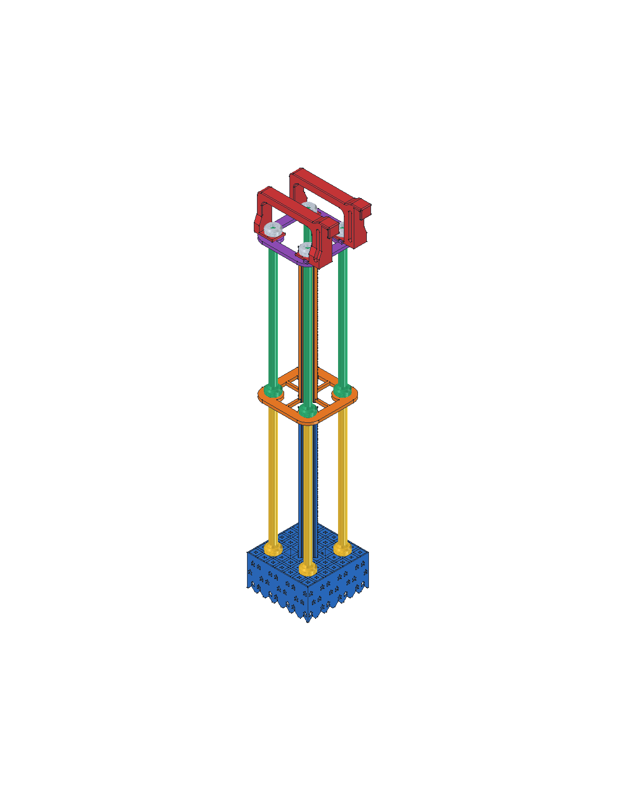

# Soporte modular para 40 biobolas

Soporte desmontable para acuario marino, con dos módulos de 20 biobolas,
hotel inferior de cámaras, dos refugios verticales, tapa y dos asas.
Descansa sobre su base; los ganchos estabilizan su posición.

La base inferior y los elementos centrales son **hoteles para copépodos y
microfauna**, con huecos y superficies de refugio pensados para sus necesidades
y pasos de agua destinados a reducir la acumulación de detrito.

Azul: base y refugio inferior. Naranja: separador y refugio superior. Amarillo
y verde: columnas inferiores y superiores. Violeta: tapa. Rojo: asas.
Gris claro: tuercas. Los colores del CAD identifican las piezas; no prescriben
el color del filamento.

## Archivos

- [FreeCAD editable del conjunto](soporte-biobolas.FCStd)
- Seis modelos 3MF neutros, en milímetros y a escala 1:1, con las piezas ya orientadas para imprimir y apoyadas sobre Z=0

| Modelo 3MF | Piezas incluidas | Envolvente total, X × Y × Z |
| --- | ---: | --- |
| [Hotel inferior con torre y cuatro roscas](hotel-inferior.3mf) | 1 | 70 × 70 × 174,6 mm |
| [Separador con refugio vertical](separador.3mf) | 1 | 65 × 65 × 144,4 mm |
| [Ocho columnas](columnas-8.3mf) | 8 | 65 × 65 × 164 mm |
| [Tapa plana](tapa.3mf) | 1 | 65 × 65 × 5 mm |
| [Dos asas con gancho, frontal y trasera](asas-2.3mf) | 2 | 83,525 × 96,8 × 15 mm |
| [Cuatro tuercas superiores](tuercas-4.3mf) | 4 | 40 × 40 × 7 mm |

Son **17 piezas**. Importar cada archivo una vez: las cantidades ya están
incluidas. Las columnas se distribuyen en 3 × 3 con una esquina libre y las
tuercas en 2 × 2. Las
asas son especulares. Todas las piezas permanecen independientes y pueden
recolocarse o repartirse en tandas según la cama disponible.

Los [3MF](https://3mf.io/spec/) contienen geometría y unidades, sin perfiles de
impresora, material o trayectorias. Cada usuario debe generar su propio
laminado. No imprimir el montaje completo del FreeCAD como un único bloque.

## Material

Usar **PETG convencional de composición conocida**, preferiblemente natural
sin pigmentos y con ficha técnica del fabricante. Evitar mezclas desconocidas
y filamentos con aditivos antimicrobianos, cargas metálicas, fibras, madera
o efectos decorativos sin evaluación para inmersión marina.

El PETG es un candidato por su resistencia al agua y adhesión entre capas,
como describe la [guía de Prusa](https://help.prusa3d.com/article/petg_2059).
La formulación concreta importa: ni «PETG», ni «natural», ni «apto para
alimentos» garantizan inocuidad para peces, corales o microfauna. No aplicar
pinturas, resinas o selladores por defecto.

## Paredes, relleno y circulación

Las **paredes suficientemente gruesas, continuas y bien fusionadas** aportan
resistencia y [reducen las infiltraciones](https://blog.prusa3d.com/watertight-3d-printing-pt1-vases-cups-and-other-open-models_48949/)
hacia el relleno. Así se limita la acumulación de agua y residuos en huecos
internos difíciles de limpiar, donde una renovación insuficiente puede
favorecer el agotamiento del oxígeno.

Como punto de partida para boquilla de **0,4 mm**:

| Ajuste | Recomendación |
| --- | --- |
| Paredes | **4–6 perímetros en las secciones que lo permitan**, aproximadamente 1,7–2,7 mm con líneas de 0,42–0,45 mm; comprobar el grosor efectivo en la vista de capas |
| Paredes estrechas del hotel | Resolver todo su espesor con líneas unidas, sin un hueco entre ellas. El número de perímetros no aumenta el espesor definido por el CAD |
| Capas superiores e inferiores | Aproximadamente 1 mm donde la geometría lo permita, sin discontinuidades en los cierres |
| Relleno | Preferir secciones macizas en columnas, tuercas y fijaciones de las asas, usando relleno local al 100 % donde haga falta |
| Altura de capa | 0,16–0,20 mm para conservar roscas, ventanas y relieves |
| Temperatura, caudal y refrigeración | Ajustar al filamento para obtener líneas y capas bien fusionadas, sin burbujas ni huecos |

Los [ensayos de Prusa sobre estanqueidad](https://blog.prusa3d.com/watertight-3d-printing-pt1-vases-cups-and-other-open-models_48949/)
respaldan la importancia de los perímetros. **Ni un espesor concreto ni el
relleno al 100 % garantizan estanqueidad o ausencia de zonas anóxicas.** Revisar
el resultado real; no confiar únicamente en los valores del laminador.

Las cámaras y canales del refugio son huecos intencionados: deben conservar
sus aberturas y circulación. No cerrarlos con relleno ni con reparaciones
automáticas de malla. Mantener libres los pasos laterales y bajo la base y
retirar el detrito que pueda obstruirlos.

## Orientación y adhesión

La orientación incluida en los 3MF es la utilizada por las limitaciones
físicas de la impresora del autor; **ambas asas apoyan toda su cara plana en
la cama**. Otras orientaciones pueden mejorar la resistencia al alinear las
capas con las cargas previstas, pero requieren revisar apoyos, puentes y
encajes en cada máquina.

## Preparación para el acuario

1. Retirar hilos, rebabas y residuos. Rechazar piezas con grietas, delaminación, huecos entre líneas o desprendimientos
2. Lavar con agua y cepillo suave, enjuagando cámaras y roscas. Terminar con agua de ósmosis/desionizada; evitar detergentes y productos antibacterianos
3. Como comprobación preventiva, remojar 48–72 horas en un recipiente separado con agua salada a condiciones de uso y circulación. Liberar el aire atrapado, desechar el agua y enjuagar
4. Comprobar el montaje mojado, su apoyo y el roscado manual con la carga prevista, sosteniendo la base

El remojo no certifica inocuidad ni descontamina un filamento desconocido.
No instalar piezas que desprendan partículas, color, olor persistente o una
película superficial; la ausencia de esas señales tampoco demuestra seguridad
biológica.

## Montaje y mantenimiento

Enroscar cuatro columnas en la base y cargar cinco biobolas por columna.
Colocar el separador, enroscar las cuatro columnas superiores y cargar las
otras veinte bolas. Añadir tapa y asas, con las caras planas hacia el interior,
y cerrar con las cuatro tuercas superiores, sólo a mano.

La referencia de las bolas es Ø31 mm exterior, 29 mm de altura y paso axial
nominal de 10,5 mm. La base mide 70 × 70 mm y la altura total es 394,4 mm.
Los ganchos tienen abertura de 6,25 mm para vidrio de 6 mm: comprobar el encaje
sin forzar. Las uniones superiores conservan unos 4 mm nominales de roscado.

Mantener circulación, acceso de limpieza y separación de calentadores.
Sostener la base al manipular el conjunto; no levantar toda la carga por las
asas ni por las láminas. No hay una capacidad de suspensión validada.

Revisar grietas, deformación, uniones flojas y canales obstruidos durante el
mantenimiento. Limpiar suavemente los refugios por partes para conservar
colonización. Retirar las piezas deterioradas y evitar agua hirviendo,
disolventes y baños químicos sin un procedimiento compatible con el material.

## Procedencia y alcance

Adaptación de **Cradle / Maxspect Bio-balls Holder**, de **luke_cooke**.
El original declara `BY-NC-SA`, sin versión especificada; se conservan la
atribución, el uso no comercial y compartir igual de la fuente.

Recomendaciones revisadas el **16 de octubre de 2026**. Son orientativas:
no constituyen una certificación de seguridad marina, una carga máxima
homologada ni una validación física del conjunto completo.
