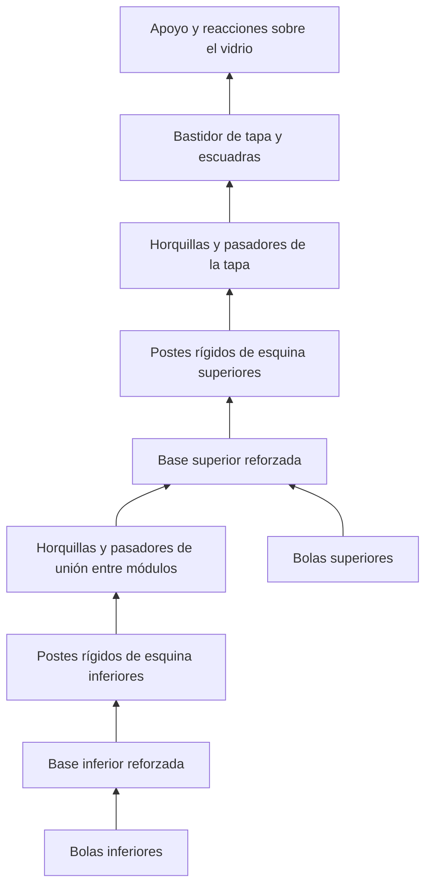

# Soporte modular de biobolas y tapa de suspensión

El nuevo diseño y su CAD inicial se desarrollan en
[Bastidor triangulado para biobolas](soporte-biobolas-bastidor/README.md).
Esta ficha conserva los antecedentes y el análisis que llevaron a la decisión.

Revisión física y propuesta del 12 de octubre de 2026. Estado: **v1 impresa con
fallos en los laterales portantes y fragilidad comunicada en base y tapa;
rediseño del conjunto pendiente. V2 no impresa, según el propietario**. El
conjunto funcional no está aceptado ni representa una instalación validada en
Veril.

Arquitectura seleccionada tras considerar la flexibilidad de los elementos
altos: **bastidor abierto triangulado, con cuatro paneles laterales imprimibles
acostados, base y marco superior rígidos, y uniones guiadas con pasadores cortos
retenidos**. La selección final se desarrolla al final de esta ficha. Los
apartados previos conservan el diseño y las comparaciones como antecedentes.
El contrato de restricciones para la siguiente iteración figura en la sección
final: apilamiento y fabricación con soportes mínimos forman parte del diseño
de las interfaces, no son ajustes posteriores de laminado.

## Objetivo y referencias

Cada módulo es una pieza monolítica para 20 biobolas Mantis, distribuidas en
cuatro mástiles X con cinco bolas por mástil. Dos módulos idénticos e
intercambiables reúnen las 40 bolas adquiridas. El primer prototipo de tapa se
imprimió, pero se rompió durante la retirada de los soportes, según comunica el
propietario. Se conserva el laminado fallido y se ha preparado una variante
paramétrica separada para imprimir con la base sobre la cama y soportes localizados.

Se conservan la altura de bola de 29 mm elegida por el propietario, el diámetro
exterior de 31 mm y el paso lateral de 36,5 mm. El peso declarado es de unos
25 g por bola: el módulo inferior añade aproximadamente 500 g de cerámica a
su propio peso, que deberá medirse tras imprimirlo. La tapa futura soportará
ambos módulos, aproximadamente 1 kg de cerámica más las piezas impresas.

El agujero de referencia es Ø10,5 mm. El sketch existente de la biobola usa
radio interior de 5,5 mm, equivalente a Ø11 mm. La probeta conserva Ø10,5 mm
como referencia y debe contrastarse con las bolas reales, que pueden variar.

## Fallo identificado y solución

El diseño anterior dejaba los labios debajo del techo del receptor. Al
suspender el conjunto, el módulo inferior se desplazaba hacia abajo y sus
labios se alejaban del techo. La prueba CAD permitía separar los módulos
0,4, 1 y 4 mm sin colisión. La ausencia de intersecciones en reposo no
demostraba retención axial.

La revisión utiliza cuatro ganchos exteriores integrados: dos orientados en X
y la pareja añadida en Y. Cada gancho atraviesa su ventana correspondiente del
módulo superior. Sus caras inferiores quedan **por encima de los hombros
portantes de la base superior**. Tras consumir 0,3 mm de juego axial, esas
caras apoyan sobre los hombros e impiden la extracción hacia abajo. Los cuatro
tetones y alojamientos conservan la función de alineación; no se atribuye la
retención a su fricción.

El recorrido de carga es: bolas → apoyos y bastidor inferior → montantes
laterales → lengüetas y ganchos X/Y → hombros del módulo superior → bastidor
superior. La revisión geométrica actual encuentra un solape portante de 0,5 × 8 mm por
gancho: 4 mm² por cierre y 16 mm² en total si los cuatro apoyan por igual.
Se corrige el cálculo anterior de 28,8 mm², que sobredimensionaba la longitud
de contacto. El CAD no demuestra ese reparto real de carga.

El corte muestra el gancho del módulo inferior en naranja y el receptor
superior en azul. Los fragmentos azules están conectados por paredes laterales
fuera del plano de corte. La cara inferior horizontal del gancho apoya sobre
el bloque azul exterior, a la derecha de la ventana.

## Parámetros e implantación

La hoja `SupportParameters` gobierna las dimensiones de la unión. Los dos
perfiles de gancho son sketches completamente restringidos, extruidos con
operaciones nativas de PartDesign. Los radios se aplican al final.

| Parámetro | Valor de esta revisión |
| --- | ---: |
| Longitud flexible nominal | 18 mm |
| Espesor y anchura de lengüeta | 1,8 × 8 mm |
| Proyección del diente | 1,8 mm |
| Radio en la raíz del diente | 1,0 mm |
| Rampa respecto a la dirección vertical de inserción | 35° |
| Espesor del hombro portante | 3 mm |
| Ventana radial × tangencial | 4,2 × 8,6 mm |
| Holgura axial en reposo | 0,3 mm |
| Desplazamiento de cabeza para liberar | Parámetro actual: 0,8 mm hacia dentro; recorrido completo pendiente de comprobación |
| Superficie horizontal efectiva sobre el hombro por gancho | 0,5 × 8 = 4 mm² |
| Holgura entre la bola superior y el módulo siguiente | 2 mm |
| Paso entre módulos | 150 mm |
| Envolvente de una pieza | 81 × 81 × 155,871 mm |
| Altura de dos módulos ensamblados | 305,871 mm |

El conjunto se sitúa junto al vidrio derecho de C1: `assemblyCenterX = 29 mm`
alinea nominalmente el extremo del soporte con la cara interior del vidrio en
`X=69,5 mm`. En Y permanece centrado, dejando 2 mm hasta cada vidrio frontal y
trasero. Las bolas conservan unos 6,75 mm de separación respecto al vidrio
derecho. Esta tangencia CAD es para la visualización; no incorpora tolerancia
de montaje ni silicona. La base comienza a 25 mm del fondo: se ocupa parte del
hueco inferior inicialmente previsto de 50 mm, conforme a la autorización del
propietario. El punto más alto queda a 330,871 mm del fondo, con 22,129 mm
hasta el nivel de agua de 353 mm. Las bolas ocupan Z=28–173 mm y Z=178–323 mm.

El paso incluye 3 mm de base, 145 mm de apilamiento de bolas y 2 mm de holgura
superior. Los cuatro tetones se elevan con el paso y los postes de guiado se
prolongan para mantener su unión. Los ganchos también suben mediante sus
parámetros derivados, conservando el apoyo de 0,3 mm sobre el hombro receptor.

La separación lateral nominal entre bolas sigue siendo de 5,5 mm. Las bases
mantienen la estructura abierta. La tapa aún no está incluida en estas cotas.

Los brazos de los cuatro mástiles quedan orientados a 0° y 90° en planta,
alineados con los nervios de la base. El giro anterior de 45° hacía que el
arranque pareciera desplazado, aunque los ejes ya estaban centrados. Sus
posiciones ahora dependen mediante expresiones de los centros de esos nervios:
se conservan los ejes X/Y = ±18,25 mm y la sección de dos brazos de 8,5 × 2 mm.
La probeta del mástil reproduce esta misma orientación. Se mantiene un
solapamiento de 0,2 mm entre el arranque y la base para asegurar la unión sólida.

Se han retirado las doce barras elevadas `SphereSeat`: eran tres barras
centradas por columna, no tres apoyos radiales exteriores. Sus extremos
formaban los salientes alrededor del pie y quedaban dentro del agujero de la
bola del modelo. El apoyo inferior se conserva sobre los nervios abiertos de
la base, alineados con el mástil. Las cuatro bolas inferiores tienen distancia
CAD cero al soporte sin intersección volumétrica. El contacto con la cerámica
real y su estabilidad siguen pendientes de la prueba física.

## Comprobación geométrica

Las siguientes observaciones proceden del modelo recomputado en FreeCAD:

- El módulo es un único sólido válido, con volumen de 57,780 cm³ y altura
  inferior a los 180 mm de la Kingroon KP3
- Las representaciones auxiliares contienen 20 bolas por módulo y no
  presentan intersección volumétrica con sus soportes
- En la posición de visualización actual, el soporte ocupa X=−11,5–69,5 mm y
  Y=−40,5–40,5 mm: queda tangente a la cara interior del vidrio derecho y
  dentro de la envolvente interior de C1. Las bolas terminan en X=62,75 mm
- Las cuatro bolas superiores del módulo inferior tienen 2 mm de distancia CAD
  al módulo superior, sin intersección volumétrica
- Los módulos ensamblados no se intersecan en la posición de reposo
- Un intento de separación axial de 0,4 mm produce cuatro zonas de solapamiento
  en los ganchos X/Y, con volumen total de 1,488 mm³: esa posición sería
  impedida por los topes. Una separación de 1 mm también queda bloqueada
- La probeta de un solo cierre también está libre en reposo, bloquea el
  intento de separación de 0,4 mm y permite la retirada comprobada a 3 mm
  con la cabeza desplazada hacia dentro

El radio de raíz de los ganchos se aumentó de 0,6 a 1,0 mm para suavizar la
transición de los brazos flexibles. La pareja nueva en Y usa sketches
restringidos y operaciones nativas de PartDesign, con los mismos parámetros de
los perfiles X. Con los cuatro cierres, el módulo recalcula como un sólido
válido, los módulos no se intersecan en reposo y el desplazamiento axial de
0,4 mm queda bloqueado con 1,488 mm³ de solapamiento CAD en cuatro zonas. La
prueba de retirada con la cabeza desplazada 1,2 mm hacia dentro se documentó
con el radio anterior y debe repetirse con la probeta actualizada. El cambio no
demuestra resistencia a fatiga ni mejora mecánica física; ambas requieren
impresión y ensayo.

La prueba de liberación traslada rígidamente la cabeza recortada para comprobar
espacio disponible. No simula la deformación elástica de la lengüeta, la fuerza
de accionamiento, las tensiones ni la resistencia del PETG impreso.

## Fabricación y resultados de las probetas

Material de las recetas preparadas: PETG, boquilla de 0,4 mm. El módulo se
imprime verticalmente con la base sobre la cama, como una sola pieza. El paquete
reúne probetas de mástil, agujero Ø10,5 mm, gancho macho, receptor y dos peines
de ajuste para el vidrio. El usuario confirma que ha impreso todas las pruebas
y comunica los siguientes resultados físicos (11 de octubre de 2026):

- La ranura de 6,00 mm entra en el vidrio con un margen muy estrecho y ajuste
  satisfactorio. Se adopta como referencia de la interfaz desnuda para este
  ejemplar de vidrio, PETG y proceso de impresión; no se extrapola como
  tolerancia universal.
- El mástil entra correctamente tanto en el agujero circular como en una
  biobola real.
- La presilla y su encaje con el receptor funcionan correctamente.

No se han comunicado medidas con calibre, número de ciclos, fuerza de montaje
ni ensayo de carga. Por ello los resultados validan cualitativamente esos
encajes individuales, no la resistencia, repetibilidad ni vida útil de las
uniones.
Las probetas de cierre representan un cierre individual; no ensayan una carga
repartida entre cuatro cierres ni el montaje completo con los cierres X/Y.
Las probetas macho y receptor reproducen el hombro, la ventana, la rampa y el
radio del modelo revisado, con agujeros Ø3 mm para sujeción durante las pruebas.
El primer peine de cristal tiene ranuras de 7, 8 y 9 mm. La referencia de 9 mm
presupone vidrio nominal de 6 mm, almohadillas de 1 mm por cara y 0,5 mm de
juego por cara; la de 7 mm evalúa el vidrio desnudo. La ranura de 7 mm presentó
juego. La segunda serie tiene ranuras de 6,00, 6,25 y 6,50 mm; la ranura de
6,00 mm entra en el vidrio real con margen muy estrecho y ajuste satisfactorio.
El espesor exacto del vidrio no se midió con instrumento de precisión. Este
resultado conserva 6 mm como referencia nominal para la interfaz desnuda y la
combinación ensayada, pero no valida la silla completa: los peines no incorporan
su acolchado ni ensayan rigidez, reacciones al giro o carga suspendida.

Antes de imprimir y usar el conjunto completo:

1. Las probetas ya están impresas y los encajes comunicados arriba funcionan.
   Revisar en las piezas impresas el voladizo de la cara portante y el puente
   del receptor, además de la retirada de soportes.
2. Confirmar inserción vertical, enclavamiento y liberación manual. La carga
   debe apoyar en las caras horizontales y no mantener la lengüeta presionada
   hacia dentro. Comprobar que no aparece apertura espontánea al tirar
3. Como prueba inicial propuesta, someter el cierre de la probeta a 1 kg
   durante 10 minutos y repetir montaje/desmontaje. Registrar el resultado y
   cualquier marca, blanqueamiento, grieta o deformación residual
4. Tras aceptar el encaje individual, probar la unión completa a cuatro cierres
   fuera del acuario. Se propone una carga de comprobación de 2 kg durante 10 minutos,
   seguida de comprobación con las 20 bolas y de evaluación bajo carga en
   ambiente húmedo. Estas pruebas aún no se han ejecutado

La carga axial de los montantes y lengüetas solicita la unión entre capas FDM.
El CAD no aporta una resistencia admisible ni certifica comportamiento a largo
plazo, fluencia del PETG o fatiga tras ciclos de accionamiento. La tapa y su
unión necesitarán su propia comprobación con la carga total suspendida.

## Tapa superior: revisión del prototipo CAD

La primera tapa presentaba un fallo de retención: el recorte de la base a
75 × 75 mm eliminaba los hombros exteriores de los receptores. En el CAD,
bajar el módulo superior 0,4 mm respecto a esa tapa no encontraba un tope. Se
ha sustituido por una base con los **cuatro receptores completos**, reproducidos
mediante operaciones nativas de PartDesign y las expresiones de
`SupportParameters`. Con la base corregida, ese desplazamiento genera cuatro
zonas de solapamiento, con un volumen total de 1,488 mm³. Es una comprobación
de retención geométrica; no demuestra resistencia mecánica.

La tapa incorpora dos escuadras en el plano XZ, alineadas con los nervios del
bastidor en Y=±18,25 mm. Cada escuadra tiene una pestaña inferior continua,
un montante de 10 × 8 mm y una cartela amplia. Las transiciones de las cartelas
llevan radio de 3 mm. Ambas escuadras se unen a una silla sobre el canto del
vidrio derecho, con un puente de 8 mm de espesor y 60 mm de longitud de apoyo
en Y. El recorrido de carga es: ganchos del módulo superior → receptores de la
tapa → bastidor reforzado → escuadras con cartelas → puente acolchado → canto
del vidrio.

La posición del peso hacia el interior genera un momento de giro. Tomando
solo el kilogramo declarado de cerámica, su centro en X=29 mm y el centro
nominal del canto en X=72,5 mm, resulta aproximadamente
9,81 N × 0,0435 m = **0,43 N·m**. El peso de las piezas impresas incrementará
esa demanda. Los dos apoyos interiores bajos y el apoyo exterior alto deben
reaccionar a ese momento: **no son simples estabilizadores**. Se representan
con almohadillas separadas, sin un apriete deliberado sobre el vidrio.

El asa está centrada sobre la torre en X=29 mm, Y=0 mm. Su plano es XZ y permite
introducir los dedos desde delante o detrás. La abertura bajo el tramo de
agarre mide 40 mm de ancho; su cara inferior está a Z=378 mm, 25 mm por encima
del nivel nominal del agua. El punto superior del asa está a Z=386 mm, por
debajo del borde de la urna. Los cantos del agarre llevan radio de 2 mm. Al
levantar, el esfuerzo se aplica sobre el centro de las biobolas y se transmite
al bastidor mediante un travesaño central reforzado.

`LidAssembly` es un único sólido válido. Su envolvente es X=−11,5–83 mm,
Y=−40,5–40,5 mm y Z=325–399 mm. Los perfiles de las dos escuadras y del asa
están completamente restringidos. La hoja `LidParameters` gobierna las cotas
del vidrio, el apoyo, las secciones y el agarre. La base ya no contiene una
forma recortada estática. Los objetos de `LidContactPads` son volúmenes de
referencia del acolchado y quedan separados del cuerpo imprimible.

| Parámetro del prototipo revisado | Valor CAD |
| --- | ---: |
| Grosor nominal del vidrio | 6 mm |
| Juego lateral de referencia por cara | 0,5 mm |
| Espesor de almohadilla de referencia | 1 mm |
| Longitud de apoyo sobre el canto en Y | 60 mm |
| Sección de cada montante | 10 × 8 mm |
| Espesor del puente sobre el canto | 8 mm |
| Radio de las transiciones de cartela | 3 mm |
| Abertura libre bajo el agarre | 40 mm |
| Cara inferior y superior del agarre | Z=378 / 386 mm |
| Envolvente de la tapa | 94,5 × 81 × 74 mm |

El grosor nominal de 6 mm y el canto a Z=390 mm proceden del modelo de C1. La
probeta de 6 mm ha entrado en el vidrio real con margen muy estrecho, pero no se
midió el espesor con instrumento de precisión. La nueva abertura de 6,5 mm no
se ha probado todavía en la silla de la tapa. El primer prototipo se imprimió,
pero se rompió al retirar sus soportes; la variante actual aún debe imprimirse.
Después habrá que revisar el contacto con el vidrio y ensayar el conjunto
completo fuera del acuario con la carga real y las reacciones al giro. El CAD no
determina la resistencia del vidrio ni del PETG impreso, su fluencia o cómo se
reparte la carga entre los cuatro cierres.

### Variante paramétrica para imprimir la tapa con la base sobre la cama

El propietario comunicó una abertura interior de 9 mm en el gancho sobre el
cristal. Confirmó que no instalará almohadillas y pidió dejar 6,5 mm para el
vidrio nominal de 6 mm. El archivo original
[soporte-biobolas.FCStd](soporte-biobolas.FCStd) queda intacto. El derivado
[soporte-biobolas-tapa-fdm.FCStd](soporte-biobolas-tapa-fdm.FCStd) modifica la
hoja `LidParameters` y elimina del duplicado los volúmenes de referencia de
acolchado:

| Parámetro de la variante | Valor |
| --- | ---: |
| Grosor nominal de vidrio | 6 mm |
| Almohadilla | 0 mm; sin acolchado |
| Holgura por cara | 0,25 mm |
| Abertura interior resultante | 6,5 mm |
| Grosor de la pared exterior del gancho | 3,2 mm, antes 6 mm |
| Borde inferior de las cartelas | 325 mm, alineado con `seatZ` |
| Envolvente de la pieza | 90,45 × 81 × 73 mm |

La pared de 3,2 mm es una primera reducción candidata, todavía sin ensayo de
carga. Alinear el borde inferior de las cartelas con el plano de la base hace
que esa zona apoye en la cama y evita el puente inferior de unos 73 mm presente
en la primera prueba de orientación. La primera variante de laminado sin soportes se descartó antes de imprimir: conservaba un puente de aproximadamente 55 mm en la silla, un vano de unos 40 mm bajo el asa y la pared exterior del gancho suspendida.

El laminado actual VBTAPS.GCO usa soporte normal snug manual únicamente bajo esas tres zonas; no se pintan los encajes ni los pequeños voladizos de la base.

La separación vertical es de 0,30 mm y la lateral de 0,50 mm, con relleno de soporte espaciado a 4 mm y dos capas de interfaz a 0,60 mm. Se busca facilitar la retirada en PETG, pero todavía no se ha comprobado físicamente. El acabado, la abertura de 6,5 mm y la resistencia siguen pendientes de prueba. El informe de laminado conserva la selección, los parámetros efectivos y las evidencias.

## Insertos desmontables para microfauna

Prototipo CAD añadido y revisado para FDM el 11 de octubre de 2026.
`MicrofaunaInsert` es un Body
independiente con operaciones nativas de PartDesign. `UpperMicrofaunaInsert`
es un enlace a la misma pieza, situado 150 mm más arriba: se necesitan dos
impresiones iguales. La hoja `MicrofaunaParameters` gobierna las dimensiones,
las guías y la posición, vinculadas al paso y a los nervios del soporte.

Cada inserto ocupa el hueco central entre las cuatro columnas. Tiene tres
láminas verticales de 1,6 mm, separadas por dos canales de 4 mm, con una
profundidad de 12 mm. Una espina une las láminas y contiene diez ventanas de
4 × 12 mm, cinco por canal, para permitir comunicación transversal. Los
canales quedan abiertos por delante, por arriba y parcialmente por abajo:
los apoyos cruzados ocupan únicamente una parte del paso inferior. Las
dimensiones son una propuesta de fabricación y espacio de refugio, no un
óptimo biológico demostrado.

Dos apoyos cruzados descansan sobre los nervios de la base. Cuatro guías bajan
2 mm por su cara interior, con 0,3 mm de juego nominal por lado. Las guías
quedan conectadas por una cruz inferior dentro del hueco del bastidor. Las
láminas y la espina también se prolongan hasta ese plano inferior para que
su arranque esté apoyado desde la primera capa. Los canales conservan pasos
inferiores abiertos entre los brazos. No hay clips,
apriete ni retención frente a una inversión del conjunto. Para retirarlo hay
que separar los módulos, o quitar la tapa en el módulo superior, y levantar
el inserto mediante una pinza o herramienta en la oreja con orificio en
lágrima: mantiene el círculo de paso Ø3 mm y añade un techo a 45° mediante
un sketch completamente restringido y un Pocket. Se han aplicado radios de
0,6 mm en seis aristas del arranque de las láminas, que suavizan su unión con
los apoyos y reducen localmente la sección libre de los canales en la raíz.
El inserto no participa en la suspensión ni modifica los cierres portantes.

Comprobaciones del CAD:

- Un único sólido válido, sin errores en las operaciones, de 9,609 cm³
- Envolvente de 38,5 × 38,5 × 142 mm, incluyendo los apoyos y la oreja
- Inserto inferior en Z=26–168 mm y superior en Z=176–318 mm
- Contacto con el soporte sin intersección volumétrica, en ambos módulos
- Sin intersección con las bolas, con distancia mínima de aproximadamente
  1,54 mm, ni con la tapa superior
- Superficie de la primera capa, calculada mediante un corte de 0,01 mm
  próximo al fondo, de 245,12 mm². Antes de la revisión, los extremos de las
  cuatro guías sumaban solo 20,48 mm² y no estaban conectados en ese plano
- Un levantamiento de 40 mm del inserto inferior no produce intersección
  con sus bolas ni con su soporte. Es una posición comprobada, no una
  simulación continua del recorrido completo

Material previsto: PETG y boquilla de 0,4 mm. La orientación inicial propuesta
es vertical, con altura de 142 mm, inferior al volumen de la KP3. La cruz
inferior y el arranque de las láminas forman una base continua. Los extremos
portantes de los apoyos sobresalen 2,3 mm de esa cruz, a 2 mm sobre su plano
inferior: debe revisarse ese pequeño voladizo en el laminado. También deben
comprobarse los puentes de 4 mm de las ventanas y el techo del orificio en
lágrima. La revisión reduce la necesidad geométrica de soportes, pero no
demuestra una impresión sin ellos. Se ha laminado una receta candidata sin
soportes. La
estabilidad de las láminas durante la impresión, las holguras con el bastidor
y con varias bolas reales y la retirada completa siguen pendientes. Las
mallas y los proyectos laminados se conservan en la entrega enlazada al final.

La función secundaria buscada es ofrecer superficies colonizables y pequeños
espacios protegidos con renovación de agua. Su colonización, acumulación de
detrito y utilidad para copépodos o anfípodos no están comprobadas. Debe poder
retirarse si dificulta el mantenimiento o el paso de agua.

## Archivos

- [Fuente FreeCAD editable](soporte-biobolas.FCStd): contiene el contexto C1,
  las bolas auxiliares, el módulo, su enlace de montaje superior, la tapa, los
  insertos de microfauna, cuatro probetas de unión y las dos series de la
  probeta de cristal, ambas integradas como grupos de cortes editables
- [STL del módulo](soporte-biobolas-modulo.stl): centrado en X/Y y con base Z=0,
  derivado del sólido con cuatro cierres, huella 81 × 81 mm
- [STL de las probetas de unión](soporte-biobolas-probeta-ajuste.stl): cuatro sólidos
  independientes colocados para imprimir en una misma placa
- [STL de la probeta de cristal](soporte-biobolas-impresion/modelos/probeta-cristal.stl):
  peine independiente con ranuras de 7, 8 y 9 mm; la ranura de 9 mm corresponde
  a vidrio nominal de 6 mm más almohadillas de 1 mm por cara y holgura de 0,5 mm
  por cara. La de 7 mm comprueba directamente el vidrio sin acolchado
- [STL de ajuste de cristal](soporte-biobolas-impresion/modelos/probeta-cristal-6_00-6_25-6_50.stl):
  peine con ranuras de 6,00, 6,25 y 6,50 mm. La ranura de 6,00 mm ha entrado en
  el vidrio real con margen muy estrecho y ajuste satisfactorio; no se midió el
  espesor exacto ni se deriva una compensación universal del PETG
- [Sección de la unión](soporte-biobolas-union-seccion.png): vista de inspección,
  sin incorporar sus recortes temporales al FCStd ni a los STL

Los STL originales, incluido el calibre de cristal, se regeneran desde la revisión
original del FCStd. El derivado FDM de la tapa y su malla se conservan aparte.
Los STL no contienen perfiles de laminado ni constituyen evidencia de una impresión
o una prueba de carga.
La tapa, los insertos y ambas series de la probeta de cristal disponen de mallas y laminados en
[soporte-biobolas-impresion/](soporte-biobolas-impresion/README.md).

## Laminado candidato

El [informe y los archivos de impresión](soporte-biobolas-impresion/README.md)
contienen once proyectos independientes: módulo, tres versiones de tapa, inserto, cuatro tipos
de probeta de unión y dos variantes de probeta de cristal. Cada archivo imprime
una unidad. Para el conjunto se necesitan
dos módulos, una tapa y dos insertos. La entrega usa Kingroon KP3
`KP3-3DP180`, boquilla de 0,4 mm y Winkle PETG Jet Black de 1,75 mm, con recetas
candidatas de OrcaSlicer 2.4.2. El informe conserva los perfiles efectivos,
orientaciones, soportes, estimaciones, sumas y límites. Las probetas se han
impreso y sus encajes individuales se han comprobado. La primera tapa falló al
retirar los soportes; la nueva variante aún debe imprimirse y probarse antes de
evaluar la carga y el uso en húmedo.

## Revisión general del conjunto — 11 de octubre de 2026

Esta revisión se conserva como antecedente. La propuesta de mantener cuatro
cierres altos queda superada por los resultados físicos comunicados el día 12
y por la propuesta de arquitectura que figura al final.

Se inspeccionó el documento abierto `soporte_biobolas_tapa_fdm`, fuente del
laminado actual de la tapa, y se contrastó con el original. Esta revisión no
modificó geometría, cotas ni G-code. Las comprobaciones usan las formas actuales;
no incluyen un ensayo FEM, una simulación de deformación o una prueba física del
conjunto. No se forzó un recálculo del documento: el sketch auxiliar de la
biobola figura como `Touched`, sin errores observados en los sólidos principales.
Las [medidas y resultados de la revisión](soporte-biobolas-revision-general.json)
conservan la procedencia y las comprobaciones de interferencia.

| Área | Resultado comprobado y alcance |
| --- | --- |
| Sólidos y sketches | Módulo, tapa e inserto: un sólido válido por pieza; sketches estructurales completamente restringidos |
| Montaje | Sin intersección volumétrica entre módulos, tapa, insertos, bolas y vidrios del contexto en la posición actual |
| Retención axial | Ambas uniones quedan bloqueadas en cuatro zonas al desplazar el elemento inferior 0,4 mm hacia abajo: aproximadamente 1,488 mm³ de solapamiento en cada unión |
| Apoyo de los cierres | 0,5 × 8 mm efectivos por cierre, 16 mm² totales nominales; se corrigió el valor anterior de 28,8 mm². No se verificó el reparto de carga |
| Holgura sobre bolas | 2 mm entre las bolas más altas y el siguiente módulo o la tapa |
| Implantación | Tangencia al vidrio derecho; 2 mm hasta cada vidrio frontal/trasero y 25 mm bajo la base. Se conserva la posición solicitada |
| Silla del vidrio | Abertura de 6,5 mm, pared exterior de 3,2 mm y sin almohadillas; geometría sin penetración en el vidrio nominal, ajuste real aún pendiente |
| FDM | Alturas de 155,871 mm para módulo, 73 mm para tapa y 142 mm para inserto: caben en la KP3. Las mallas coinciden con las envolventes y volúmenes CAD dentro de la aproximación de triangulación |
| Inserto | Sin intersección con bolas ni soporte; separación mínima a las bolas de 1,544 mm. Canales de 4 mm y láminas de 1,6 mm; utilidad biológica y mantenimiento aún sin prueba |

La retención axial es geométricamente coherente. La superficie de apoyo efectiva
es menor que la documentada antes de esta revisión, por lo que no se puede
atribuir resistencia al conjunto a partir de las probetas individuales. La unión
módulo–tapa recibe la carga de las 40 bolas y de ambas piezas; la unión entre
módulos recibe el módulo inferior. Mantener el conjunto pegado al vidrio no
elimina el momento de giro de la carga suspendida. Las superficies de contacto,
los cierres y las raíces entre capas deben revisarse en la prueba de carga real.

Las siguientes mejoras se proponen sin ejecutarlas, por orden de prioridad:

- Aumentar el solape portante de los dientes hacia aproximadamente 1 mm,
  comprobando de nuevo las ventanas, el recorrido de liberación y las
  probetas. Los 0,5 mm actuales equivalen a poco más de una línea de 0,42 mm;
  la holgura radial de guiado de 0,3 mm permite que un desplazamiento lateral
  reduzca el solape nominal de un lado hasta aproximadamente 0,2 mm. Esta
  comparación geométrica identifica sensibilidad a tolerancias; no calcula
  una resistencia admisible ni demuestra un fallo físico. Mantener la
  arquitectura de cuatro cierres y ensayar cualquier cambio de su interfaz.
- Añadir un pequeño chaflán de entrada, por ejemplo 0,5 mm a 45°, en la boca de
  la silla y suavizar cantos de contacto. Conservar la abertura útil de 6,5 mm
  y la superficie portante. Primero comprobar que las operaciones no debilitan
  la pared de 3,2 mm; no reducir más su espesor antes del ensayo.
- Comprobar el enclavamiento de los cuatro cierres y su liberación en el montaje
  completo. Con solo 2 mm a los vidrios frontal y trasero, no se ha demostrado
  el accionamiento con los dedos dentro de C1. La maniobra inicial propuesta
  es extraer la torre completa por el asa y separar los módulos fuera del acuario.
- Probar progresivamente el conjunto con sus 40 bolas y piezas reales fuera del
  acuario, registrando asentamiento, apertura de cierres, marcas, deformación y
  repetición de montaje. La prueba breve no valida por sí sola uso prolongado
  bajo carga ni comportamiento en húmedo.

Se mantendrían los mástiles ya probados, las cartelas, el asa centrada y los
insertos desmontables. La geometría básica de cuatro cierres se conserva como
propuesta; ampliar su apoyo obligaría a comprobar nuevamente las interfaces
afectadas, sin trasladar la aceptación de las probetas anteriores a la variante. El último laminado
VBTAPS.GCO conserva soporte localizado bajo la silla, la pared exterior del
gancho y el asa; el módulo utiliza su soporte de árbol y el inserto permanece
sin soporte. La retirada de los soportes de la nueva tapa sigue pendiente de
prueba física.

Hay dos discrepancias de representación que no se deben confundir con medidas
nuevas: el agujero de la biobola auxiliar sigue siendo Ø11 mm frente a Ø10,5 mm
de referencia física, y las etiquetas del paso C1→C2 mencionan 50 mm aunque su
geometría y la hoja representan 28 mm. No se cambiaron esas cotas ni se tomó la
etiqueta como evidencia de la medida real.

## Replanteamiento tras la impresión de v1 — 12 de octubre de 2026

El propietario identifica las piezas fotografiadas como **v1** y confirma que
**v2 no se ha tocado ni impreso**. La fecha exacta de impresión de los módulos
y del inserto no se ha indicado. La revisión fotográfica y los resultados
atribuidos están en el [registro de revisión física](../../04_operaciones/2026/10/2026-10-12-revision-fotografica-soporte-biobolas.md).
El conjunto v1 no está aceptado. La impresión satisfactoria de las probetas
cortas no acredita la fabricación de los laterales completos.

### Interpretación limitada de los fallos

Las fotos muestran bandas de superficie irregular en los laterales altos,
junto a mástiles de acabado más uniforme. El propietario sitúa el comienzo de
la deformación aproximadamente a media altura y considera que los laterales
«bailan». La distinta sección y rigidez de esos elementos hacen plausible
una flexión durante la impresión. Es una hipótesis: faltan vídeo del proceso,
altura medida de inicio del defecto y asociación exacta con receta y bobina.
Las fotos no permiten descartar problemas locales de deposición o refrigeración.

La fragilidad de la base y de la tapa es una valoración física del propietario.
Las imágenes de la tapa muestran un tramo del bastidor separado y material
auxiliar aún adherido. No permiten medir rigidez ni atribuir toda la fragilidad
al espesor. La rotura al retirar soportes ya está documentada para v1.

### Alternativas de estructura

| Alternativa pendiente | Ventaja buscada | Compromiso que debe comprobarse |
| --- | --- | --- |
| Mantener módulo monolítico, reforzar base y arriostrar los laterales | Menos piezas y conservación de la interfaz | Sigue imprimiendo elementos altos y cierres en su extremo; los refuerzos deben dejar pasar las bolas y permitir liberar los cierres |
| Separar base, bastidores laterales rígidos y cierres cortos | Imprimir los bastidores acostados y separar guiado, estructura y bloqueo | Añade montaje, holguras y uniones portantes que requieren probetas y comprobación de espacio |

La segunda alternativa fue la propuesta inicial. Tras comparar las uniones,
se prioriza la variante de esquinas rígidas con pasador descrita en la sección
final, todavía sin CAD nuevo ni aceptación física. No basta con engrosar las presillas: se
replantea la continuidad estructural desde la base inferior hasta el vidrio.

### Propuesta de rediseño del conjunto

1. **Base abierta reforzada.** Conservar los pasos de agua y los apoyos de las
   cuatro columnas. Aumentar el canto resistente de los nervios y del marco,
   unir sus encuentros con transiciones suaves y reforzar los arranques de
   mástiles y elementos portantes. El refuerzo debe crecer dentro del espacio
   disponible, con revisión del paso entre módulos, del hueco inferior y del
   asiento del inserto. No se fija todavía un espesor sin evaluar esa geometría.
2. **Bastidores laterales separados.** Estudiar marcos abiertos con montantes
   unidos por travesaños, imprimibles acostados. Las uniones con la base y el
   módulo siguiente deben tener hombros de apoyo definidos y bloqueo positivo
   accesible. Los mástiles de las bolas mantienen su función de guiado. Toda
   barra nueva debe comprobarse contra la carga y descarga de las bolas.
3. **Cierres cortos independientes.** Estudiar una corredera o pasador retenido
   que bloquee la separación entre módulos, accesible fuera del acuario.
   Su sección y retención se determinarán con probetas. Si se conserva una
   lengüeta flexible, será corta y separada del montante portante. No depender
   de fricción para sostener el módulo inferior ni la torre completa.
4. **Tapa coordinada con la base.** Sustituir el bastidor frágil por una
   estructura compatible con las nuevas uniones. Estudiar escuadras y agarre
   imprimibles de lado, con apoyo amplio en cama y uniones ensambladas
   accesibles. Dimensionar base, escuadras, contacto con vidrio y asa según
   su función y recorrido de carga. La pared de 3,2 mm de la variante anterior
   no se adopta como espesor validado.
5. **Soportes mínimos y retirables.** Resolver primero mediante orientación,
   división de piezas y geometría los vanos de la silla y del asa. El objetivo
   es evitar soportes en cavidades o contra elementos frágiles. Si queda una
   zona que los necesite, debe poder retirarse sin hacer palanca sobre el
   bastidor, las uniones o el gancho. No se promete impresión sin soportes
   antes de revisar la geometría y el laminado.
6. **Hotel de pods conservado.** Mantener inicialmente el inserto que se ha
   impreso bien. Revisar únicamente su asiento, holguras y recorrido de
   extracción frente a la nueva base. Su impresión satisfactoria no demuestra
   colonización ni rendimiento biológico.

Se mantienen como restricciones de partida las 40 bolas, dos módulos de 20,
la distribución de cuatro columnas, Ø31 mm y altura de bola de 29 mm, el paso
lateral de 36,5 mm, el espacio central del inserto y la implantación junto al
vidrio derecho. La base actual ocupa 81 × 81 mm y deja 2 mm a los vidrios
frontal y trasero: no hay margen para añadir bastidores exteriores sin revisar
la envolvente. Se conserva el objetivo de abertura de 6,5 mm en el vidrio
desnudo, sin almohadillas. Las cotas anteriores son restricciones documentadas,
no medidas nuevas de estas fotos.

La unión inferior transmite aproximadamente 500 g de cerámica más el módulo;
la tapa recibe aproximadamente 1 kg de cerámica más todas las piezas. Son
pesos declarados. Debe revisarse también el momento de giro sobre el vidrio,
ya descrito arriba, y la carga al extraer la torre del agua.

### Siguiente fase y aceptación

El siguiente trabajo es revisar las interfaces y dibujar el nuevo recorrido de
carga antes de crear un derivado paramétrico independiente. Las piezas deben
caber en 180 × 180 × 180 mm, incluidas su orientación y adhesión. Las secciones
y holguras quedarán justificadas en el nuevo diseño y comprobadas mediante
probetas de base, unión y gancho antes de otra impresión completa.

La aceptación requiere retirada de soportes sin roturas, montaje y desmontaje
repetibles, base sin deformación que altere los apoyos, bloqueo positivo de
módulos, extracción del inserto y ensayo fuera del acuario con la carga real.
La comprobación húmeda y bajo carga sostenida seguirá siendo una fase distinta.
No se han ejecutado esas pruebas ni se han modificado CAD, STL, 3MF o G-code.
La variante v2 se conserva como antecedente y deja de ser el siguiente paso
propuesto mientras se replantean la base y la tapa.

## Selección mecánica tras comparar referencias — 12 de octubre de 2026

**Selección inicial, sustituida por la decisión final al considerar la
flexibilidad lateral: cuatro esquinas rígidas con uniones de
horquilla y pasadores transversales retenidos, base abierta reforzada y tapa
adaptada a la misma interfaz.** Es una selección de arquitectura, no una
certificación de resistencia ni una modificación del CAD. Se prioriza frente
a separar todo el módulo en bastidores porque los postes de esquina ya se
imprimieron satisfactoriamente y esta vía añade menos interfaces estructurales.
Su resistencia entre capas sigue pendiente de ensayo.

### Referencias recuperadas y alcance de uso

Consulta web realizada el 12 de octubre de 2026. No se descargaron modelos ni
se copiaron geometrías. Estas son fuentes primarias del fabricante o autor.
Disponibilidad actual de una publicación no demuestra uso continuado ni
validación mecánica actual del modelo.

| Referencia y procedencia | Lo que declara o muestra | Aplicación y límite en Veril |
| --- | --- | --- |
| [CaddyStack, Printed Reef](https://printedreef.com/pages/caddystack), página comercial disponible en la consulta | Torre de medios con bandejas desmontables que encajan entre sí y soporte para el hueco del calcetín | Referencia de modularidad y mantenimiento. La página consultada no aporta carga admisible ni ensayo equivalente a nuestra suspensión desde el vidrio. No se trasladan sus afirmaciones comerciales de rigidez ni su esquema de filtración |
| [Print Bed Shelving, gil.a.ramirez](https://forum.snapmaker.com/t/snapmaker-printable-print-laser-cnc-bed-organizer-shelving-system/28867), publicación del autor del 8 de enero de 2023, accesible en la consulta | Estantería impresa para las camas de su Snapmaker, con ranuras superiores e inferiores y pasadores impresos para conectar módulos; fotografías de piezas y conjunto | Demuestra un montaje físico atribuido al autor. Una estantería apoyada trabaja de modo distinto a una torre suspendida; no acredita retención axial bajo tracción para Veril |
| [Modular Enclosure, Tyler Spurgeon](https://www.printables.com/model/681278-modular-enclosure-for-3d-printer), descripción del autor recuperada por búsqueda, actualización indicada el 18 de mayo de 2025 | Estructura modular de esquinas y largueros, montaje con tornillos y construcción de su cerramiento comunicada en agosto de 2024 | Referencia para separar elementos rígidos. El autor distinguía piezas de apilamiento aún no impresas en diciembre de 2023. La apertura directa de Printables falló; no se inspeccionaron mallas ni se verificó la variante apilada |
| [Modeling with 3D printing in mind, Prusa](https://help.prusa3d.com/article/modeling-with-3d-printing-in-mind_164135), documentación técnica consultada | La orientación y la geometría afectan la integridad; dividir piezas permite optimizar orientación y reducir soportes; las tolerancias requieren iteración | Respalda estudiar la orientación por componente. No proporciona resistencia admisible para nuestro PETG, impresora o unión |
| [Slotted Spring Pins Design Guide, SPIROL](https://www.spirol.com/assets/files/sltp-slotted-spring-pin-design-guide-us.pdf), apartado Shear Properties, página 9 del PDF | Distingue cortadura simple y doble y advierte que material del alojamiento, separaciones y condiciones de carga alteran la capacidad de una unión | Referencia del mecanismo de carga y de la necesidad de validar el montaje. Los valores de sus pasadores metálicos, sus tolerancias y las reglas de ajuste por interferencia no se aplican al PETG impreso |

### Comparación y criterio de elección

| Solución | Evaluación para este conjunto |
| --- | --- |
| Presillas altas integradas en los laterales | No se prioriza: v1 presenta fallos de fabricación en esos elementos y combina flexibilidad de accionamiento con estructura portante |
| Esquinas con un tetón vertical de alineación, sin bloqueo transversal | Insuficiente para suspensión: al colgar el módulo inferior puede separarse. El ajuste por fricción no define retención positiva |
| Dos orejetas solapadas con un pasador en cortadura simple | Posible, pero introduce excentricidad y un solo plano de cortadura; no es la primera opción |
| Horquilla de dos orejetas y lengüeta central, con pasador transversal | Preferida: dos planos nominales de cortadura, trayectoria de carga local definida y bloqueo visible. Exige verificar orejetas, raíz, flexión del pasador y retención |
| Cola de milano con un seguro independiente | Alternativa viable si la horquilla no cabe; puede transmitir tracción por superficies amplias, pero requiere comprobar labios, entrada lateral, holguras y extracción con detrito |
| Bastidores separados imprimibles acostados | Reserva si fallan las raíces o postes entre capas. Mejora la orientación de los elementos largos, pero añade uniones en sus extremos y más montaje |

### Cómo debe transmitir carga la opción elegida

Cada módulo conservaría su base y los cuatro mástiles de guiado. Se eliminan
los laterales flexibles altos. Los cuatro postes de esquina pasan a ser
elementos portantes y terminan en lengüetas rígidas. La base del módulo
siguiente incorpora una horquilla local que recibe cada lengüeta. La tapa
recibe las cuatro lengüetas del módulo superior mediante la misma interfaz.

En suspensión, el pasador **sí puede ser portante**: transmite la fuerza entre
lengüeta y horquilla. Los asientos de apilamiento reciben compresión cuando el
conjunto se apoya, pero no sustituyen esa retención al colgarlo. Las caras de
guiado de la unión deben impedir giro y reducir el juego; cuatro pasadores no
garantizan por sí solos un conjunto sin flexión lateral.

Cada pasador tendrá cabeza en un extremo y retención positiva desmontable en
el otro. El seguro debe quedar fuera de los planos de cortadura y ser
accesible con la torre fuera de C1. No se adopta una fricción a presión como
única retención ni una presilla larga que deba mantenerse flexionada bajo carga.
Cabeza y seguro quedan dentro de la envolvente al instalar el conjunto.

La primera vía conserva postes integrados con la base, reduciendo el número
de piezas. Para los extremos de horquilla se estudiarán perfiles abiertos o
en lágrima y soporte local accesible. Los pasadores se imprimirán acostados
con una sección que apoye estable en cama, revisando diámetro efectivo y
acabado. Una probeta debe representar la orientación vertical de los postes
y raíces; imprimir solo la unión acostada no valida el módulo propuesto.

### Predimensionado: demanda, sin resistencia admisible confirmada

Se adopta únicamente para este cálculo una masa total de **1,25 kg**: el
kilogramo declarado de cerámica más una reserva de 250 g para piezas y agua
retenida. No es una medición ni una cota superior garantizada. Debe pesarse la
torre mojada al extraerla. Se aplica un multiplicador de carga de **3** para
explorar una demanda de `F = 1,25 × 9,81 × 3 = 36,79 N`. Este multiplicador
es una decisión preliminar, **no un factor de seguridad demostrado**.

Para no depender del reparto perfecto entre cuatro esquinas, el cálculo local
asigna los 36,79 N a una sola unión. No representa todas las fuerzas posibles:
un tirón, un atasco o un momento aplicado pueden generar demandas mayores.

Una probeta candidata usa pasador nominal `d=4 mm`, agujero nominal
`dh=4,3 mm`, lengüeta de espesor `t=4 mm` y anchura `b=10 mm`, dos orejetas
de `c=3 mm` y ligamento de `e=3 mm` desde el borde del agujero hasta el extremo
cargado. Los 0,3 mm diametrales son una hipótesis para probetas, no un encaje
heredado. La envolvente de la horquilla incorpora además el juego de montaje.
Estas cotas **no se han comprobado aún en CAD ni llevado a un laminado**.

| Comprobación nominal | Fórmula, con N y mm | Resultado |
| --- | --- | ---: |
| Cortadura media del pasador en dos planos | `F / (2 × π × d² / 4)` | 1,46 MPa |
| Cortadura media si solo resulta eficaz un plano | `F / (π × d² / 4)` | 2,93 MPa |
| Presión proyectada en la lengüeta | `F / (d × t)` | 2,30 MPa |
| Presión en cada orejeta, reparto simétrico ideal | `(F / 2) / (d × c)` | 1,53 MPa |
| Tracción media en sección neta de lengüeta | `F / ((b − dh) × t)` | 1,61 MPa |
| Arrancamiento nominal por dos ligamentos | `F / (2 × e × t)` | 1,53 MPa |
| Tracción media en poste macizo de 6 × 6 mm, sin agujero | `F / 36` | 1,02 MPa |

Son demandas medias idealizadas. No incluyen concentraciones de tensión,
flexión del pasador, flexión o apertura de orejetas, esfuerzo de raíz,
anisotropía FDM ni fluencia. **No se concluye que la unión aguante**: falta
resistencia admisible medida para esa receta, orientación y condición húmeda.
Tampoco se emplea la resistencia de una ficha de PETG como resistencia entre
capas de esta pieza.

### Encaje espacial y refuerzo de la base

La inspección de `Document.xml` del FCStd original confirma postes
`CornerGuidePost00–11` de 6 × 6 mm y 147,2 mm de altura, y marco de base con
largueros de 3 mm de ancho y 3 mm de canto. Se leyó el archivo sin editarlo
ni recalcular geometría. Taladrar nominalmente 4,3 mm en una sección de 6 mm
dejaría solo 0,85 mm por lado: la nueva cabeza debe ensancharse y enlazarse
con el poste mediante una transición resistente.

Hay un límite geométrico útil. Para una esquina cuadrada alineada con X/Y,
contenida en 81 × 81 mm y frente a una bola de radio 15,5 mm centrada en
X/Y=18,25 mm, el lado máximo sin tocar su envolvente circular es:

`40,5 − (18,25 + 15,5 / √2) = 11,29 mm`.

Es un límite en planta de la envolvente nominal, a la altura de máxima anchura
de las bolas, sin holgura adicional ni consideración de silicona, cabezas de
pasador o montaje. Una esquina cuadrada de 12 × 12 mm que llegue al borde
exterior invadiría esa envolvente en esas alturas. No se aplica directamente
a una cabeza situada en otra cota Z, donde debe usarse la sección real de la bola. Una
horquilla compacta cercana a 10–11 mm merece estudio, pero su recorrido de
inserción, longitud del pasador y acceso requieren comprobación CAD completa.
No se declara que quepa por este cálculo bidimensional.

La base debe conectar los cuatro asientos de bolas con las cuatro esquinas
portantes mediante nervios continuos y encuentros reforzados, conservando el
hueco del inserto. Aumentar un nervio rectangular de 3 a 6 mm de canto, con
igual anchura, longitud y material, multiplica su segundo momento de área por
8 y su módulo resistente por 4 para flexión fuera del plano. Es una relación
geométrica, no una predicción de rigidez de toda la base ni un espesor aprobado.
Debe decidirse dónde crece ese canto: crecer hacia abajo modifica los 25 mm
libres al fondo; crecer hacia arriba puede desplazar bolas, paso entre módulos
y tapa. No se cambia silenciosamente ninguna de esas cotas.

### Tapa, vidrio y prueba que decide la viabilidad

La tapa se replantea con cuatro receptores de esquina, nervios que conduzcan
la carga hasta las escuadras y asa conectada a esa estructura. Se estudiará la
división de las escuadras para imprimirlas de lado si evita soportes atrapados.
Cada unión nueva necesita retención portante propia. Se conservan como
restricciones el vidrio nominal de 6 mm, la abertura de 6,5 mm y la ausencia
de almohadillas solicitada por el propietario.

El momento no desaparece con los pasadores. Con el brazo documentado de
43,5 mm, el kilogramo de cerámica genera 0,43 N·m. El escenario de cálculo de
36,79 N genera 1,60 N·m. Si el par se equilibrara mediante apoyos separados
solo 30 mm en altura, su reacción sería `1,60 / 0,030 = 53,34 N`. Esta
separación es un ejemplo de sensibilidad, no una medida del apoyo real. Deben
calcularse las reacciones con las posiciones finales y evaluarse presión y
flexión del vidrio. Las pruebas de sobrecarga se harán en un útil fuera del
acuario, sin trasladarlas al vidrio de Veril.

La opción pasa a CAD de conjunto solo tras resolver estas verificaciones:

1. Comprobar espacio en las cuatro esquinas, asiento de bolas, acceso al
   pasador, retención y extracción del hotel. Verificar agujeros y ligamentos
   sin perder el hueco central ni superar la cama con el brim.
2. Preparar una probeta que incluya base, raíz, poste y unión, con orientación,
   material y receta equivalentes. Probar montaje y seguro durante al menos
   20 ciclos y ensayar tracción progresiva de una sola esquina hasta 36,79 N
   en un útil. Registrar desplazamiento, apertura, grietas y deformación
   residual. Estos son criterios propuestos, no pruebas ejecutadas.
3. Imprimir un módulo completo para comprobar estabilidad durante toda la
   altura: la probeta corta no demuestra ese comportamiento. Ensayar base con
   sus 20 bolas y registrar flexión de apoyos, ajuste y retirada.
4. Ensayar la torre con la masa mojada real y las condiciones de suspensión y
   extracción en un útil, verificando también el momento de la tapa. Mantener
   una prueba húmeda inicial de siete días a carga de servicio con medidas
   periódicas. Siete días detectan problemas tempranos; no validan la vida útil.

La geometría de la esquina se descarta si exige paredes finas, invade las
bolas o necesita soporte inaccesible. Si el ensayo falla por apertura de la
horquilla se revisarán sus secciones y raíces; si falla por separación entre
capas en los postes, se reconsiderarán bastidores impresos acostados. La
elección se mantiene como **candidata mecánicamente justificable y pendiente
de comprobación geométrica y física**.

## Análisis ampliado de fallos y condiciones de viabilidad

Continuación del análisis del 12 de octubre de 2026. La familia de uniones en
esquinas sigue siendo preferible a las presillas altas, pero **el pasador de
4 mm y la horquilla compacta todavía no constituyen una solución cerrada**.
La comparación inicial de cortadura era incompleta para decidir su tamaño:
también importan flexión, rigidez del conjunto, disposición de la unión y
fabricación de la base. Los modos de fallo siguientes son hipótesis de diseño,
salvo los defectos de v1 expresamente identificados como observados.

### Flexión del pasador y rigidez de los postes

Para la lengüeta de 4 mm y las orejetas de 3 mm, se explora un juego axial de
0,3 mm **por interfaz entre lengüeta y orejeta**. Es distinto del juego
diametral de 0,3 mm propuesto entre agujero y pasador. La distancia entre
centros de reacción de las dos orejetas resulta
`L = 4 + 2 × 0,3 + 3 = 7,6 mm`.

Un modelo de viga simplemente apoyada con carga central concentrada da
`M = F × L / 4 = 69,90 N·mm` para `F=36,79 N`. Con carga central uniforme a
lo largo de los 4 mm de la lengüeta, y manteniendo reacciones concentradas en
los centros de las orejetas, da `M = F × (2 × L − t) / 8 = 51,50 N·mm`.
Para un pasador circular macizo, `σ = 32 × M / (π × d³)`:

| Diámetro explorado, con iguales espesores y separación | Cortadura media en dos planos | Flexión con carga central uniforme | Flexión con carga central concentrada |
| --- | ---: | ---: | ---: |
| 4 mm | 1,46 MPa | 8,20 MPa | 11,12 MPa |
| 5 mm | 0,94 MPa | 4,20 MPa | 5,70 MPa |
| 6 mm | 0,65 MPa | 2,43 MPa | 3,30 MPa |

Estos modelos no reproducen el contacto real ni acotan todos sus máximos.
Sirven para identificar sensibilidad: aumentar el diámetro reduce la demanda
de flexión, pero agranda el agujero y debilita o ensancha los alojamientos.
No se adopta 5 o 6 mm automáticamente. Un pasador aplanado tampoco se calcula
como un cilindro completo: debe usarse su sección real y su orientación.

[SPIROL, The Impact of Clearance on the Shear Properties of Coiled Spring Pins](https://my.spirol.com/resources/white-papers/the-impact-of-clearance-on-the-shear-properties-of-coiled-spring-pins/),
de Christie Jones, describe cómo las separaciones y avellanados pueden hacer
que una unión falle por flexión antes que por cortadura. Se aplica aquí el
principio mecánico, sin trasladar sus capacidades ni tolerancias metálicas.
En la propuesta, los chaflanes de entrada se limitarán a los extremos externos
y no vaciarán los bordes cargados entre lengüeta y orejetas.

Los postes de 6 × 6 mm y 147,2 mm pueden tener baja tensión axial media y,
sin embargo, ser flexibles lateralmente. Como sensibilidad, usando un módulo
elástico **supuesto**, no medido, de `E=1500 MPa`, una sección maciza da
`I=6⁴/12=108 mm⁴`. Un poste en voladizo tendría
`δ = H × 147,2³ / (3 × E × I) = 6,56 mm por N` de fuerza lateral en su
extremo. Cuatro voladizos idénticos con reparto perfecto darían 1,64 mm por N
de fuerza lateral total. No son desplazamientos predichos para la torre
ensamblada: la base superior, los guiados, la tracción axial y la rigidez de
raíces cambian las condiciones. La conclusión es que **resistir el peso axial
no demuestra rigidez lateral**, ni una impresión correcta demuestra ninguna
de esas dos propiedades.

### Modos de fallo del conjunto y respuesta de diseño

La prioridad indica qué debe resolverse antes de avanzar, no una probabilidad
de fallo. No hay datos para asignar frecuencias ni puntuaciones numéricas.

| Parte y posible problema | Consecuencia o mecanismo | Respuesta y comprobación necesaria |
| --- | --- | --- |
| Pasador: flexión entre apoyos | Curvatura, contacto concentrado y posible rotura aunque la cortadura media sea baja | Reducir separaciones, calcular sección real y medir deformación de la unión cargada. Prioridad alta |
| Pasador: fractura o pérdida de sección por el seguro | Una ranura para retención puede debilitar el tramo portante | Cabeza, ranura y seguro fuera de ambos planos cargados; ensayar el pasador exacto, no un cilindro ideal. Prioridad alta |
| Pasador: salida axial accidental | La lengüeta puede quedar sostenida por una sola orejeta o liberarse | Cabeza y seguro positivo visible, sin fricción como única retención. Comprobar longitud de inserción y que no exista un estado parcialmente insertado que parezca cerrado. Prioridad alta |
| Pasador: capas, diámetro o cara inferior defectuosos | La orientación acostada mejora continuidad longitudinal pero puede perjudicar forma y contacto | Probeta con sección imprimible y calibre del diámetro funcional; revisar superficies y ensayo con la receta real. Prioridad alta |
| Horquilla: apertura de orejetas | El apoyo pasa de simétrico a excéntrico y aumenta la flexión | Orejetas conectadas a un cuerpo rígido, raíces anchas y guiado que reciba cargas laterales. Ensayar también una carga descentrada. Prioridad alta |
| Lengüeta y orejetas: aplastamiento, ovalización o arrancamiento | El agujero crece o el ligamento se desgarra, aumentando juego antes de romper | Material suficiente en dirección de carga y alrededor del agujero, sin soportes adheridos en caras críticas; medir agujeros y juego antes y después. Prioridad alta |
| Unión: holguras acumuladas | La torre asienta, se inclina o golpea durante la extracción | Separar juego de agujero, juego entre piezas y guiado. Dos uniones con 0,3 mm diametrales pueden acumular aproximadamente 0,6 mm de asiento axial idealizado, sin contar flexión ni desgaste. Verificar la cadena real. Prioridad alta |
| Cuatro esquinas: agujeros que no coinciden | Forzar pasadores introduce tensiones y puede abrir o romper orejetas | Referencias de posición comunes, chaflanes exteriores y probeta de cuatro esquinas. No resolverlo agrandando agujeros sin revisar reparto y asiento. Prioridad alta |
| Cuatro esquinas: reparto desigual | Una esquina comienza a cargar antes que las otras | Mantener análisis local sin suponer cuatro cargas iguales y comprobar el montaje completo. La prueba de una esquina no demuestra redundancia. Prioridad alta |
| Falta de un pasador | Giro y redistribución pueden desencadenar separación progresiva | Confirmación visual de las cuatro uniones por nivel y montaje con ambos módulos apoyados. No considerar aceptable el uso con una unión ausente. Prioridad alta |
| Poste: separación entre capas o rotura en la raíz | La unión puede permanecer cerrada mientras la estructura se desprende de la base | Ensayar una raíz con su orientación vertical real, transición amplia y nervios conectados. Si falla, reconsiderar bastidores acostados. Prioridad alta |
| Poste: flexión lateral o torsión del conjunto | Bolas, base y tapa dejan de conservar su posición relativa | Guiados con longitud de contacto y caras que limiten giro; medir desplazamiento lateral en conjunto. Un pasador redondo por esquina no aporta por sí solo un empotramiento. Prioridad alta |
| Poste: inestabilidad durante la impresión completa | Reaparece el defecto de fabricación aunque una probeta corta salga bien | Cabezas sin escalones bruscos, receta compatible y prueba a altura completa. El fallo de laterales de v1 es observado; su causa sigue sin confirmar. Prioridad alta |
| Base: flexión fuera del plano | Cambian asiento de bolas, alineación de postes y reparto de carga | Nervios de mayor canto con rutas continuas de asiento a esquina; medir con 20 bolas y bajo la carga transmitida del módulo inferior cuando corresponda. Prioridad alta |
| Base: deformación en su plano | El cuadrado se convierte en un paralelogramo y los guiados se atascan | Revisar encuentros de marco y nervios y la rigidez de los planos de unión. Una base gruesa no garantiza rigidez torsional del conjunto. Prioridad alta |
| Base: debilitamiento por receptores o ranuras nuevas | Una mejora del cierre elimina material de su camino de carga | Comprobar sección restante y raíces, conservando continuidad estructural alrededor de los huecos. Prioridad alta |
| Base: refuerzos que bloquean apoyos o mantenimiento | Bolas mal asentadas, hotel atrapado o reducción de pasos de agua | Verificar posiciones y recorridos completos de montaje y extracción, conservando el hotel como pieza independiente. Prioridad alta |
| Tapa: flexión o torsión del bastidor | La fuerza no se transmite uniformemente a escuadras y receptores | Nervios y travesaños continuos desde esquinas hasta escuadras y asa. Ensayar suspensión y elevación como casos distintos. Prioridad alta |
| Tapa: soporte de impresión atrapado | Rotura durante posprocesado, observada en v1 | Priorizar orientación o división de escuadras; revisar acceso real al soporte y retirada en una pieza representativa. Prioridad alta |
| Tapa dividida: nuevas uniones débiles | Imprimir mejor una escuadra puede trasladar el fallo al ensamblaje | Dimensionar y ensayar cada conexión, con retención positiva y sin depender de adhesivo o fricción como única unión portante. Prioridad alta |
| Gancho y apoyos: apertura o contacto puntual con vidrio | Aumentan giro y concentración de presión | Calcular reacciones con distancia real entre apoyos, ampliar contacto donde quepa y eliminar cantos agresivos. Mantener la decisión sin almohadillas. No convertir el gancho en una pinza que precargue el vidrio. Prioridad alta |
| Asa: carga descentrada o pérdida de unión con el bastidor | La extracción aplica flexión y torsión diferentes al peso suspendido | Conservar agarre centrado y continuidad resistente hasta las cuatro esquinas. Ensayar agarre y levantamiento con masa mojada. Prioridad alta |
| PETG: deformación lenta bajo carga | Agujeros, poste o gancho cambian aunque la prueba breve sea satisfactoria | Reducir tensiones y concentraciones, medir durante exposición húmeda sostenida y después de descargar. La prueba corta no acredita vida útil. Prioridad alta |
| Montaje: retirada de pasadores con carga | Un módulo puede caer y pellizcar o dañar piezas | Apoyar y descargar ambos módulos antes de liberar cualquier unión. Disponer seguros accesibles y sin piezas difíciles de sujetar. Prioridad alta |
| Montaje: piezas pequeñas perdidas | Falta un seguro o el usuario improvisa una fijación | Pasador retenido o seguro unido al conjunto, siempre que esa retención secundaria no introduzca una nueva zona débil portante. Revisar acceso con manos mojadas. Prioridad media |
| Mantenimiento: detrito en encajes | Atasco, aumento de fuerza de desmontaje y desgaste | Huecos lavables, sin bolsillos ciegos innecesarios; probar extracción tras uso húmedo y limpieza. Es una posibilidad, no una incidencia observada. Prioridad media |
| Extracción: atasco en vidrio o accesorios | Un tirón puede superar la carga calculada | Verificar la envolvente y el recorrido con la torre completa; no usar el asa para forzar un atasco ni contar con 36,79 N como máximo absoluto. Prioridad alta |

### Problema de integración: no basta con dibujar una horquilla aislada

La unión necesita mostrar en sección dónde están la base del módulo superior,
el extremo del poste inferior y el arranque del poste superior durante toda la
inserción. Debe quedar abierta en la dirección de montaje y permitir que los
dos módulos sigan siendo idénticos e intercambiables.

- Una horquilla que crezca **por debajo** de la base puede dejarla suspendida
  respecto a la cama. Cuatro pies de esquina no eliminan los puentes del
  marco y los nervios entre ellos. Esa disposición no se acepta como
  imprimible sin soporte solo por tener contacto con la cama.
- Una horquilla o cabeza que crezca **por encima** debe comprobarse contra
  las bolas inferiores del módulo siguiente y el arranque de su poste.
  La proyección circular usada antes es conservadora a la altura de máximo
  diámetro, pero no sustituye las secciones reales a distintas alturas.
- Una ranura pasante para recibir el poste inferior puede competir con la
  raíz del poste superior en la misma esquina. Ambos caminos de carga deben
  enlazarse sin una pared fina entre ellos.
- Cambiar a montaje lateral para evitar esos cruces exige comprobar la
  traslación de las cuatro esquinas a la vez, las bolas, los mástiles y el
  hotel. La maniobra se estudia fuera del acuario; no se presupone viable.

Con un margen radial adicional de 1 mm respecto a la bola, el límite anterior
de esquina cuadrada se reduce de 11,29 a
`40,5 − 18,25 − (15,5 + 1) / √2 = 10,58 mm`.
Una lengüeta de 4 mm más dos orejetas de 3 mm y dos juegos de 0,3 mm ya ocupa
10,6 mm en el eje del pasador, antes de añadir cabeza o seguro. Esta comparación
**no demuestra una colisión tridimensional**, porque compara un prisma
cuadrado conservador con una unión cuya forma y altura no están definidas.
Sí demuestra que el predimensionado inicial deja muy poco margen y no debe
cerrarse mediante un aumento general de espesores.

### Problemas específicos de las alternativas

| Alternativa | Posible ventaja | Problemas que impiden adoptarla sin comprobar |
| --- | --- | --- |
| Pasador circular de 5–6 mm | Menor demanda de flexión para igual geometría de apoyos | Agujero mayor, menos ligamento, orejetas o cabeza más voluminosas y posible interferencia con bolas; no soluciona la raíz ni la fluencia del gancho |
| Llave transversal plana | Puede imprimirse estable y dar mayor módulo resistente en la dirección de carga | Solo mejora si se mantiene la orientación de su sección; una ranura rectangular concentra esfuerzos en esquinas y puede facilitar arrancamiento. Exige guiado y seguro positivo propios |
| Pasador largo que una dos esquinas a la vez | Menos piezas que insertar | Alineación de varios agujeros, extracción de gran recorrido, flexión y atascos; no se prioriza frente a pasadores cortos independientes |
| Cola de milano o cabeza en T con seguro | Superficies amplias de retención axial, dejando al seguro la función de impedir la retirada lateral | Labios pueden abrirse o arrancarse; necesita recorrido lateral, control de tolerancias y limpieza. Debe probarse carga real y no atribuir al seguro un papel secundario antes de demostrar el apoyo bajo tracción |
| Bastidores separados impresos acostados | Orientación favorable para elementos largos y reducción de soportes | Añade conexiones a base y tapa, holguras y montaje. Puede mejorar postes y empeorar sus uniones; ocupa planos exteriores cercanos a bolas |
| Tirantes de material comercial con anclajes impresos | Permite evitar algunos elementos largos impresos bajo tracción | Requiere definir material compatible, compra y corte, anclajes y desmontaje; los anclajes impresos y la tapa siguen siendo portantes. No se ha seleccionado producto ni material |
| Estructura apoyada en el fondo con elevación inferior | Reduce la suspensión permanente y el momento sobre el vidrio | Cambia la implantación y el mantenimiento actuales; al extraerla necesita igualmente un recorrido de carga que mantenga unidos los módulos. No se adopta por inferencia |

### Agua, tiempo y alcance de las fuentes materiales

[Stankevics et al., Viscoelastic Creep of 3D-Printed Polyethylene Terephthalate Glycol Samples, 2025](https://www.mdpi.com/2073-4360/17/15/2075)
estudia probetas FFF con distintas direcciones de filamento y cargas constantes
durante 5 y 20 horas. Confirma que el comportamiento temporal y la anisotropía
deben distinguirse del ensayo instantáneo. Sus resultados no proporcionan una
resistencia admisible para Winkle PETG en la KP3 ni para la geometría propuesta.
No se trasladan sus porcentajes de resistencia o deformación a Veril.

[Gama et al., Structure–property relationships of FFF-printed PETG under UV radiation and water uptake, 2026](https://link.springer.com/article/10.1007/s10965-026-04876-9)
ensaya PETG FFF en agua destilada y salina a 70 °C durante diez semanas.
Observa efectos distintos en propiedades dinámicas y de tracción asociados a
exposición y relajación estructural. No demuestra que el agua degrade siempre
el PETG ni que lo refuerce en Veril. El ensayo acelerado a 70 °C no equivale a
una vida útil calculada en el acuario, ni acredita compatibilidad biológica
de cualquier filamento. Ambas fuentes se consultaron el 12 de octubre de 2026.

### Decisión revisada y orden de comprobación

En esta fase del análisis se mantuvo como primera candidata la **estructura rígida en esquinas**, con
base y tapa reforzadas, y retención transversal positiva. La horquilla con
pasador circular es la primera interfaz que debe compararse en sección con
una llave plana o una cabeza en T retenida. Ninguna tiene todavía geometría
cerrada ni resistencia acreditada. El diámetro de 4 mm deja de ser una cota
preferida: pasa a ser uno de los casos de comparación.

El primer filtro es geométrico y de fabricación: montaje completo de dos
módulos idénticos, base apoyada en cama, ausencia de paredes finas, espacio
para bolas e inserto, acceso a seguros y paso de agua. Si una horquilla no
supera ese filtro, se descarta aunque su cortadura nominal parezca favorable.

Después deben comprobarse resistencia y rigidez por separado: unión completa
y raíz con la orientación real, deformación lateral del módulo, flexión de
base, suspensión desde la tapa y extracción por el asa. La demanda local de
36,79 N es un escenario, no una garantía frente a cualquier momento aplicado
o atasco. Los límites de desplazamiento se fijarán a partir de las holguras
finales, del montaje y de la resolución de medida; no se inventa un límite
universal para estas piezas.

La prueba húmeda inicial de siete días se conserva para detectar fallos
tempranos. Se propone ampliarla a 30 días de observación a carga de servicio,
registrando evolución y recuperación tras descarga. Ni siete ni treinta días
constituyen por sí solos una certificación de vida útil. No se acelera la
prueba mediante calentamiento del acuario ni se carga su vidrio con el
escenario de sobrecarga del útil.

En esta fase se ha ampliado el análisis y la documentación. No se ha modificado
el CAD, generado un laminado, cambiado una receta ni ejecutado una prueba
física. La elección final depende primero de resolver la sección de montaje
y después de obtener evidencia de fabricación, rigidez y resistencia.

## Arquitectura elegida: bastidor abierto triangulado

El propietario pide escoger la opción más adecuada y destaca que la altura y
el grosor dan bastante flexibilidad. La decisión de diseño del 12 de octubre
de 2026 es **separar la estructura portante de los mástiles y formar cada
módulo con cuatro paneles laterales triangulados, una base abierta reforzada
y un marco superior abierto**. Los paneles se imprimirán acostados. Las
uniones serán guiadas y tendrán pasadores cortos con retención positiva,
diseñados para transmitir carga en dos planos de cortadura. El diámetro,
los espesores y las holguras siguen pendientes del dimensionado geométrico
y de las probetas. No se selecciona como definitiva la propuesta de 4 mm.

Esta decisión sustituye la preferencia por postes de esquina independientes
integrados con la base. Se acepta más montaje para reducir la flexión de los
elementos largos y poder estudiar una orientación de impresión favorable.
Los resultados satisfactorios de impresión de las esquinas de v1 se conservan
como evidencia, pero no bastan para seleccionar su función portante sin
arriostramiento.

### Estructura de cada módulo

- **Cuatro paneles laterales abiertos.** Cada panel tendrá dos montantes,
  travesaños superior e inferior y una diagonal integrada que forme
  triángulos. La sección de la diagonal debe admitir esfuerzos en ambos
  sentidos: tracción y compresión. No se trata de una tira flexible usada
  como tirante ni se presupone que no pueda pandear.
- **Base rígida en su plano y fuera de él.** El marco y los nervios conectarán
  los cuatro apoyos de bolas con los montantes. La base sujetará la posición
  de los cuatro paneles sin depender solo de fricción o de un único eje de
  pasador. Se mantiene el hueco del hotel y el paso de agua.
- **Marco superior abierto.** Unirá las cabezas de los cuatro paneles y
  conservará la geometría cuadrada del módulo. Se imprimirá plano y se
  ensamblará después, evitando imprimir travesaños largos en el aire. Debe
  dejar acceso vertical a las cuatro columnas de bolas y al hotel.
- **Guiado y bloqueo de las uniones.** Las caras de los alojamientos limitarán
  desplazamiento lateral y giro; los pasadores retenidos impedirán separación
  y transmitirán la carga que resulte del montaje. No se les atribuye solo
  una función de seguro. Los guiados no sustituirán los ensayos de apoyo,
  flexión y arrancamiento.

Los cuatro paneles arriostran dos direcciones perpendiculares. Dos paneles
opuestos sin resolver la dirección transversal podrían dejar la torre
flexible en el otro sentido. La base y el marco superior deben cerrar ese
camino de carga. No se considera triangulado un conjunto con diagonales
fuertes conectadas a esquinas que pueden girar o desplazarse libremente.

### Por qué se elige frente a engrosar los postes

En un elemento largo que trabaja a flexión, la longitud tiene una influencia
cúbica en el desplazamiento del modelo de voladizo utilizado antes. Aumentar
sección ayuda, pero consume el escaso espacio alrededor de las bolas y no
elimina la flexión de raíces, base y uniones. La triangulación busca transmitir
una parte mayor de la demanda lateral como esfuerzo axial de diagonales y
montantes, en vez de depender únicamente de la flexión de cuatro postes largos.

El bastidor seguirá deformándose y sus conexiones tendrán holguras. Esta
elección define un mecanismo para aumentar rigidez, no cuantifica todavía
la rigidez ni certifica que el conjunto soporte la carga. La orientación
acostada de los paneles permite continuidad de material a lo largo de sus
elementos y evita fabricar diagonales inclinadas suspendidas entre postes
altos. Se verificarán también las fuerzas que crucen capas en sus conexiones.

### Integración que debe cumplir la versión nueva

Los paneles ocuparán las franjas exteriores entre la envolvente de las bolas
y el límite del conjunto. No cruzarán las columnas ni el hueco central. El
espesor de panel, sus encuentros de esquina, las cabezas de pasador y los
seguros deben comprobarse juntos dentro de la huella actual de 81 × 81 mm.
No se amplía la huella ni se altera la implantación junto al vidrio por esta
decisión documental. Si no cabe, esta arquitectura deberá revisarse antes
de generar derivados.

Se conservarán los dos módulos iguales de 20 bolas y los mástiles que guían
las bolas. Los paneles, base y marco superior constituirán el recorrido
portante. Primero se ensamblará la estructura, después se cargarán las bolas
y se colocará el hotel por los huecos superiores. Se comprobará el recorrido
completo, no solo las posiciones finales. El marco superior y las conexiones
entre módulos deben permitir abrir ese acceso cuando sea necesario.

La unión entre módulos y la unión con la tapa se ubicarán en las esquinas,
con alojamientos rígidos y pasadores cortos retenidos. El marco superior del
módulo inferior y la base del superior deben conectarse sin que el alojamiento
debilite sus nervios. La tapa recibirá la estructura del módulo superior y
transmitirá su carga a escuadras y vidrio. El asa quedará conectada a ese
recorrido para permitir extraer la torre completa.

Las escuadras de suspensión se diseñarán como piezas separadas imprimibles
de lado si así se evitan soportes atrapados. Su unión con el bastidor de tapa
será portante y tendrá ensayo propio. El cambio no elimina el momento sobre
el vidrio, la decisión de abertura de 6,5 mm ni la ausencia de almohadillas.

### Problemas que permanecen tras escoger la arquitectura

| Problema pendiente | Criterio de resolución |
| --- | --- |
| Más conexiones y posible juego | Alojamientos con caras de guiado, montaje sin forzar y medida del desplazamiento acumulado en el conjunto |
| Diagonales bajo compresión | Sección y longitud libre compatibles con la demanda; comprobación de pandeo y deformación en ambas direcciones laterales |
| Flexión de panel fuera de su plano | Conexión de los cuatro paneles mediante base y marco superior; ensayo lateral en ambos ejes y de torsión |
| Esquinas ocupadas por paneles y uniones | Sección CAD de cada encuentro con bolas y pasadores, incluyendo sus recorridos y los seguros |
| Debilidad en pie y cabeza de panel | Probetas con conexión, raíz y orientación de fabricación reales; no trasladar resistencia de una barra aislada |
| Base y marco superior deformables | Nervios continuos, sin recortes que interrumpan rutas portantes, y medición de flexión con carga |
| Montaje o limpieza difíciles | Acceso con el módulo descargado, piezas retenidas y paso comprobado de bolas, hotel y herramientas necesarias |
| Fluencia y desgaste | Seguimiento húmedo bajo carga de servicio y comparación de holguras antes y después de ciclos |
| Tapa, gancho y contacto con vidrio | Ensayo específico de suspensión, giro y elevación en útil, con reacciones calculadas para la geometría final |

La siguiente fase de diseño parte de esta arquitectura, sin reabrir alternativas
equivalentes salvo que falle un criterio de espacio, fabricación o mecánica.
Primero se resolverán una sección de esquina y los recorridos de montaje;
después se dimensionarán paneles, diagonales, base, marco superior y tapa como
conjunto. La fabricación empezará por una probeta de unión y un panel a altura
real. El ensayo del módulo completo sigue siendo necesario para verificar
rigidez en las dos direcciones y torsión. En esta decisión no se han modificado
CAD, STL, 3MF ni G-code, ni se ha declarado aceptación física.

## Restricciones fijadas para la siguiente iteración

El propietario confirma que el sistema debe apilarse e imprimirse sin
soportes o con soportes mínimos. La iteración conserva el bastidor triangulado,
pero diseña conjuntamente **base, marco superior, unión entre módulos y tapa**.
El primer dibujo solo explicaba un módulo: sus agujeros, pasadores, grosores
y marco superior no son geometrías aceptadas ni muestran un encaje de
apilamiento resuelto.

| Requisito fijado | Condición que debe cumplir la propuesta | Comprobación pendiente |
| --- | --- | --- |
| Capacidad y modularidad | Dos módulos idénticos e intercambiables, 20 bolas por módulo en cuatro columnas de cinco, 40 en total | Montaje en ambos órdenes y carga con las bolas reales |
| Apilamiento | La base de un módulo se acopla al marco superior de otro mediante guiado y bloqueo positivo desmontable | Recorrido de inserción y extracción sin interferencias, y prueba de tracción |
| Torre suspendida | La unión entre módulos mantiene el módulo inferior al elevar todo el conjunto por la tapa | Ensayo con masa mojada real; no basta un apilamiento apoyado por gravedad |
| Interfaz con tapa | La tapa utiliza la interfaz superior del módulo y conduce la carga hasta el vidrio y hasta el asa durante extracción | Prueba diferenciada de suspensión, giro y elevación |
| Rigidez | Cuatro caras trianguladas y conexiones rígidas en base y marco superior; conservar posición de apoyos y bolas en ambos ejes y bajo torsión | Medida de deformación y comprobación de raíces, guiados y diagonales |
| Paso de agua | Laterales abiertos, base con nervios y huecos, marco superior abierto; sin paredes continuas ni obstrucción nueva del paso de agua | Revisión geométrica y observación física del conjunto |
| Referencias de bolas | Mantener Ø31 mm, altura de 29 mm, paso entre columnas de 36,5 mm y referencia de agujero Ø10,5 mm | Contraste con las bolas reales; el auxiliar CAD Ø11 mm no sustituye esa referencia |
| Hotel de pods | Conservar el inserto independiente que imprimió bien, uno por módulo, con asiento y extracción practicables | Revisar sus holguras y recorridos completos con la nueva base |
| Espacio en C1 | Conservar huella máxima de 81 × 81 mm incluyendo cierres en posición de uso, implantación junto al vidrio derecho y márgenes laterales documentados | Comprobación CAD de envolvente, silicona y montaje; no agrandar por inferencia |
| Referencias verticales | Mantener como punto de partida 25 mm libres al fondo, paso de módulo de 150 mm y 2 mm sobre las bolas antes del siguiente elemento | Resolver canto de base y marcos sin duplicar alturas; cualquier incompatibilidad se explicita antes de cambiar estas referencias |
| Vidrio | Vidrio nominal de 6 mm, abertura objetivo de 6,5 mm y sin almohadillas | Probeta de interfaz completa y revisión de contactos, sin apriete deliberado |
| Volumen de fabricación | Límite físico de 180 × 180 × 180 mm de la KP3-3DP180 para cada impresión, con la orientación elegida | Comprobar pieza, brim y cualquier soporte en X/Y y altura en Z, además de movimientos de purga y retirada. Que quepa el sólido CAD no basta |
| Proceso y material | Fabricación FDM en PETG, boquilla de 0,4 mm; receta documentada para la bobina real | Secciones imprimibles, orientación de capas y ensayo de raíces, uniones y diagonales con la receta efectiva |
| Ambiente de servicio | Estructura de los módulos sumergida continuamente en agua salada; tapa y suspensión expuestas a humedad y salpicaduras según su altura | Ensayo en agua salada representativa de Veril bajo carga sostenida; medir cambios de juego, rigidez y deformación. Registrar temperatura y salinidad del ensayo |
| Laterales | Paneles triangulados impresos acostados, con todos los elementos conectados desde cama; objetivo sin soportes | Laminado de panel y prueba de altura/longitud real |
| Base y marco superior | Caras de apoyo planas, sin orejetas inferiores que obliguen a sostener el bastidor completo; objetivo sin soportes | Primera capa, voladizos, agujeros y trayectoria de las uniones en el laminado |
| Pasadores | Piezas separadas, imprimibles acostadas sin soportes, cabeza y seguro positivo fuera de zonas portantes | Dimensión funcional, inserción completa, flexión, retención y ciclos |
| Tapa y escuadras | Dividir y orientar para evitar soportes; solo se admite apoyo localizado mínimo, accesible y retirable sin romper piezas | Vista por capas y prueba de retirada antes de ensayo de carga |
| Mantenimiento | Desmontaje con módulos apoyados y descargados, cierres accesibles fuera de C1, huecos limpiables | Montaje repetido con manos mojadas y extracción de bolas e insertos |
| Originales y evidencia | Conservar v1, v2 y sus derivados; el nuevo CAD será una fuente paramétrica separada | Trazabilidad por versión y aceptación física limitada a lo realmente ensayado |

### Consecuencia para la interfaz de apilamiento

La base del módulo superior y el marco superior del inferior deben formar
**una interfaz complementaria**, no dos aros simplemente apoyados uno sobre
otro. El guiado recibe desplazamiento lateral y limita giro; el bloqueo
positivo impide separación vertical. Los pasadores pueden transmitir carga
y se dimensionarán como elementos portantes, con comprobación de sus apoyos.
Las dos funciones se comprobarán en la misma unión fabricable.

Se evita introducir un collar adicional entre módulos que aumente altura sin
necesidad. La geometría complementaria debe alojarse en los marcos y encuentros
previstos, conservando espacio sobre las bolas. Los machos de guiado serán
cortos y rígidos; no se recuperan presillas altas ni elementos largos aislados.
La base de cualquier módulo debe poder descansar en cama sin soporte bajo
su marco y nervios. Ningún agujero o seguro se considera resuelto porque
aparezca en una imagen conceptual.

Si un alojamiento de pasador necesita soporte atrapado, elimina demasiado
material o no cabe en las esquinas, **esa geometría se rechaza**. Se revisa
la sección de la interfaz dentro de la arquitectura elegida, sin convertir
el problema en una impresión completa con soportes más difíciles de retirar.

### Consecuencias del volumen, el PETG FDM y el agua salada

Los paneles de aproximadamente 150 mm de altura se imprimirán acostados:
esa longitud pasa a ocupar X o Y, no Z. La base de 81 × 81 mm y los paneles
parecen compatibles con la cama nominal, pero deberán comprobarse los extremos
de sus encajes y el brim. No se dispone de geometría nueva para afirmar que
todos caben. La torre ensamblada puede superar 180 mm de altura porque se
fabrica por piezas; ninguna pieza ni placa de impresión puede superar el
volumen disponible. La tapa y sus escuadras se incluyen en esa comprobación.

El material fijado es PETG procesado mediante FDM. Las dimensiones y las
conexiones deben responder a esa combinación, sin adoptar propiedades de
PETG macizo o moldeado como resistencia de una unión entre capas. Los paneles
acostados resuelven la orientación de sus elementos largos, pero no garantizan
la resistencia de pasadores, alojamientos y raíces. Los perímetros y sólidos
locales deberán formar secciones continuas en las zonas cargadas; un aumento
general de relleno no sustituye esa comprobación.

La validación húmeda se realizará **en agua salada**, no únicamente con piezas
secas o sumergidas en agua dulce. Se observarán encajes, deformación bajo carga,
desgaste y recuperación tras descarga. La temperatura y salinidad usadas se
registrarán como condiciones del ensayo, sin inventar valores actuales del
acuario. Los estudios citados sobre PETG e inmersión no acreditan por sí solos
la resistencia de la bobina concreta ni la vida útil del conjunto.

Los alojamientos y marcos tendrán drenaje y acceso de limpieza. Se evitarán
bolsillos que atrapen aire durante la inmersión o retengan agua al extraer la
torre. El detrito puede afectar los encajes durante el uso; los depósitos de
sal tras secado pueden afectar el montaje posterior. Son condiciones de diseño
y mantenimiento, no incidencias ya observadas en esta pieza.

La extracción constituye otro caso de carga: al salir del agua desaparece el
alivio por flotación y puede quedar agua retenida. El dimensionado y ensayo
deben cubrir la masa mojada real fuera del agua, además de la suspensión
sumergida. Si finalmente se incorpora un componente comercial, su material
y compatibilidad con inmersión salina deberán quedar identificados antes de
adoptarlo. La propuesta actual mantiene piezas estructurales y cierres de PETG,
sin añadir herrajes por inferencia.

### Alcance de la imagen iterada

La nueva ilustración debe mostrar dos módulos iguales apilados, la interfaz
entre la base y el marco superior, el bloqueo mediante pasadores retenidos,
los paneles triangulados, los dos hoteles y la tapa de suspensión con asa.
Una vista secundaria mostrará las piezas separadas apoyadas en sus
orientaciones de impresión. Los colores distinguen funciones y piezas,
no materiales o perfiles diferentes.

La ilustración es un esquema de comunicación: no acredita holguras, espesores,
pasadores retenidos, doble cortadura, ausencia de soportes ni resistencia.
La sección de unión y el CAD paramétrico siguen pendientes. La revisión de
laminado comprobará primero fabricación y retirada; los ensayos posteriores
comprobarán rigidez, retención, carga y comportamiento húmedo.
