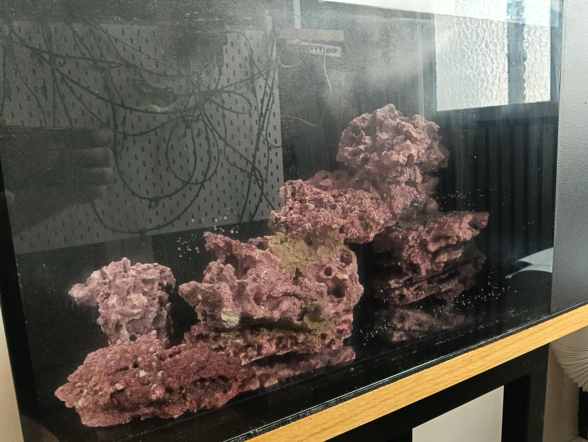
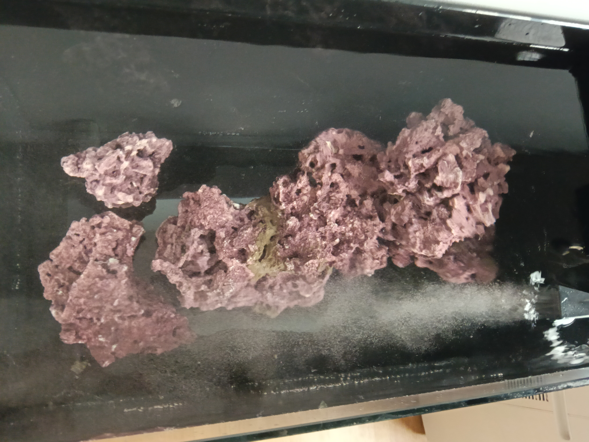
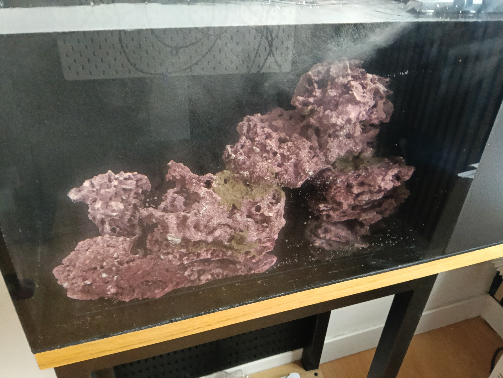
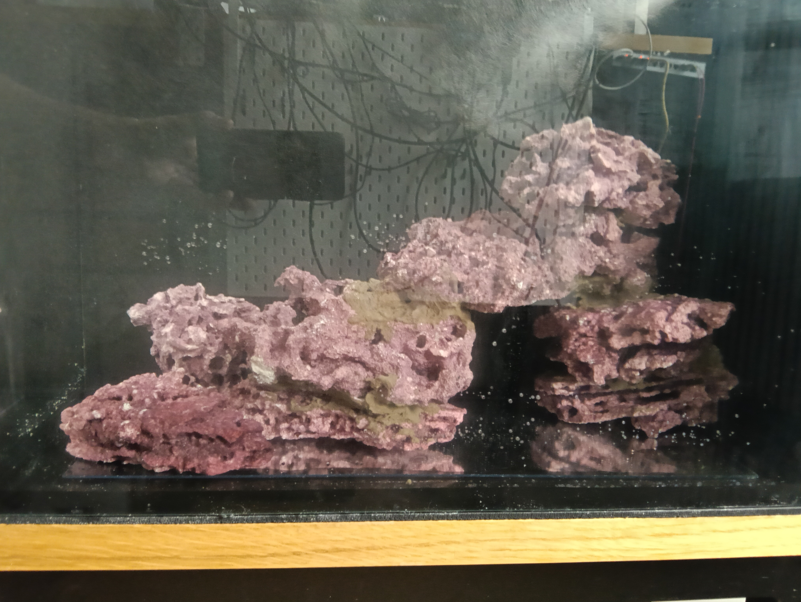

# Registro detallado del hardscape instalado

> **Corrección posterior (19/10/2026):** la bomba de retorno se identificó físicamente como **Sicce Micra**, no Micra Plus. Se conserva la denominación anterior como parte del registro histórico. Véase la [incidencia y corrección de identidad](../../10/2026-10-19-limpieza-y-medicion-caudal-retorno.md).

## Estado de la configuración

Este registro amplía la [operación de montaje y primer llenado](README.md) del
**5 de septiembre de 2026**. Las fotografías muestran el montaje con agua,
antes de aplicar el adhesivo y antes de incorporar la arena. Durante esa misma
operación, las uniones se fijaron con **AF Stone Fix**.

## Disposición observada

| Zona | Piezas identificadas | Función espacial observada |
| --- | --- | --- |
| Base izquierda | Roca 10 y Roca 07 | Apoyo bajo y arranque de la estructura principal |
| Paso y terraza central | Roca 09 y Roca 04 | Formación del hueco central y superficie elevada de transición |
| Base derecha | Roca 03 | Apoyo de la masa alta y continuidad de la estructura |
| Masa alta posterior derecha | Roca 08 sobre la zona derecha del arco | Punto de mayor altura y volumen visual |
| Isla frontal | Piezas separadas de la masa principal | Isla separada de la masa principal |
| Isla posterior | Pieza separada junto a la trasera | Isla separada junto a la trasera |

La identificación de las rocas procede de su correspondencia visual con el
inventario fotográfico.

## Lectura frontal

La vista frontal muestra una base baja a la izquierda, una terraza central y
una masa más alta en la parte posterior derecha. El paso central, las islas y
los huecos separan visualmente las masas de roca. En las superficies se
aprecian porosidad, fracturas y estratificaciones.

## Fotografías

### Vista frontal oblicua

### Vista cenital

### Vista frontal

### Vista frontal lateral

