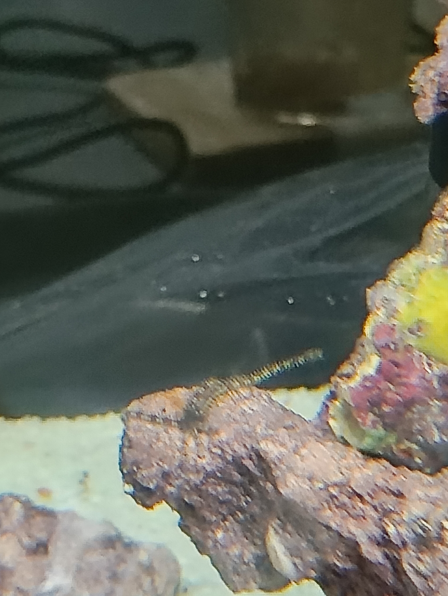

# 2026-11-19 — Operaciones de Veril

## Compra de productos

El propietario comunicó la compra de los siguientes productos:

| Producto | Presentación y datos comunicados |
| --- | --- |
| [Salifert Calcium Profi Test](../../../01_verilpedia/05_productos/19_salifert-calcium/salifert-calcium.md) | Caducidad: **04/2031**. |
| [Salifert Magnesium Profi Test](../../../01_verilpedia/05_productos/20_salifert-magnesium/salifert-magnesium.md) | Caducidad: **04/2029**. |
| [Aquaforest Life Bio Fil](../../../01_verilpedia/05_productos/28_aquaforest-life-bio-fil/aquaforest-life-bio-fil.md) | **1200 ml**. Caducidad: **02/2028**. |
| [Lunaqua Copépodos vivos Tisbe sp.](../../../01_verilpedia/05_productos/29_lunaqua-copepodos-tisbe/lunaqua-copepodos-tisbe.md) | **250 ml**. Enriquecidos con fitoplancton. Por 100 g: proteína bruta **7,8 %**, grasa bruta **3,8 %** y ceniza **0,5 %**. |
| [Lunaqua Copépodos vivos Tigriopus sp.](../../../01_verilpedia/05_productos/30_lunaqua-copepodos-tigriopus/lunaqua-copepodos-tigriopus.md) | **250 ml**. Enriquecidos con fitoplancton. Por 100 g: proteína bruta **8,1 %**, grasa bruta **2,9 %** y ceniza **0,5 %**. |
| [Fitoplancton cultivado por Elite Reef Kanarias](../../../01_verilpedia/05_productos/31_fitoplancton-elite-reef-kanarias/fitoplancton-elite-reef-kanarias.md) | **1 L**. |

## Incorporación de roca viva

El propietario añadió a Veril una roca viva que le dejó Elite Reef Kanarias.
La roca tenía bastante esponja. Al introducirla, observó una estrella de mar
diminuta que venía como polizón, del tipo que ya contemplaba incorporar.
Estimó un diámetro de **unos 2 cm** y describió los brazos como **muy finos**.

*Roca viva incorporada a Veril el 19 de noviembre.*

### Primera observación confirmada de un habitante

El propietario observó **seis brazos** con bandas de **marrón claro y oscuro**.

Las fotos `IMG20261119201124.jpg` y `IMG20261119201125.jpg` y el vídeo
`VID20261119201135.mp4` muestran brazos finos, segmentados y con bandas
claras y oscuras junto al saliente de la roca. El aspecto es compatible con
una [microofiura](../../../01_verilpedia/02_biologia/05_invertebrados/05_equinodermos/amphipholis-squamata.md).
Se registra como primer habitante confirmado de Veril. El disco central no
se distingue con detalle suficiente para identificar la especie.

**Identificación provisional.** Los seis brazos bandeados y la llegada
con roca viva con esponja hacen de *Ophiactis savignyi* la principal
candidata entre las especies comparadas en la ficha de microofiuras.
Una vista dorsal nítida del disco permitiría cotejar los escudos radiales
grandes descritos para esta especie.

*Foto original del 19 de noviembre. Los brazos se ven en el saliente, a la
izquierda de la zona amarilla.*

## Observación de un caracol

El propietario observó un caracol de **unos 5 mm** pastando algas en el
cristal delantero de Veril. Por la forma de la concha, podría coincidir con
*Tectus* o *Trochus*. El género queda sin confirmar.
