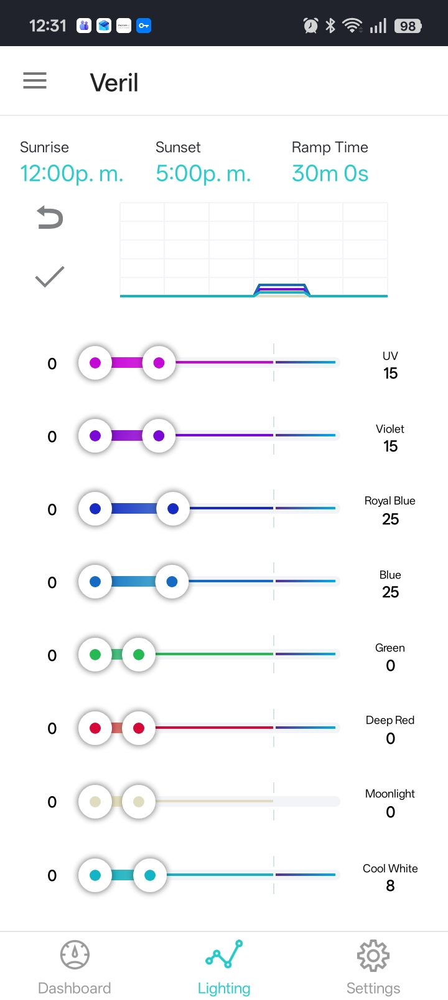

# 2026-11-20 — Operaciones de Veril

## Inicio de la iluminación

El propietario comunicó el inicio de la iluminación con la AI Prime 16HD
Reef el **20 de noviembre de 2026**. El [perfil inicial](../../../02_configuracion/01_dimensiones/04_iluminacion.md#perfil-inicial-de-maduración)
tiene como horario elegido **12:00–17:00**, hora canaria.

El propietario actualizó el ajuste de myAI. La captura actualizada muestra
*Sunrise* a las **12:00 p. m. (mediodía)**, *Sunset* a las **5:00 p. m.**
y *Ramp Time* de **30 min**.

El propietario comunicó que el horario quedó funcionando tras corregir la
hora configurada en myAI.

## Cambio de agua

El propietario retiró **12 L** de Veril y añadió **12 L** de agua salada
preparada con [Aquaforest Reef Salt](../../../01_verilpedia/05_productos/02_aquaforest-reef-salt/aquaforest-reef-salt.md),
lote **4502148**. Completó el nivel con agua RO/DI,
volvió a activar las bombas y después midió **1,025 de densidad relativa**,
el valor que buscaba.

### Mediciones tras el cambio

El propietario comunicó las siguientes lecturas, todas tomadas con Salifert.
Para KH, Ca y Mg se distingue la lectura de la jeringa del resultado
obtenido en la tabla de Salifert.

| Parámetro | Lectura de la jeringa | Resultado del test |
| --- | --- | --- |
| Alcalinidad (KH) | 5,4 | **7** |
| Calcio (Ca) | 2,2 | **390** |
| Magnesio (Mg) | 15 | **1260** |
| NH₃ | — | **0** |
| Nitrito (NO₂) | — | **0** |
| Nitrato (NO₃) | — | **25** |
| pH | — | **8** |

El propietario comunicó una temperatura del agua de **26,1 °C**.

## Adición de Lunaqua y fitoplancton

Al apagarse las luces y bajar el sol, el propietario comunicó que paró todo y
retiró **500 ml** de agua. Añadió el contenido de los dos botes de Lunaqua y
unos **65–70 ml** de fitoplancton de Elite Reef Kanarias. Indicó que el resto
quedó guardado en la nevera.

El propietario confirmó que los dos tipos de copépodos de Lunaqua quedaron
inoculados: *Tisbe* sp. y *Tigriopus* sp. Sus grupos están registrados como
[unidades incorporadas](../../../02_configuracion/03_biologia/04_unidades-incorporadas/README.md).

### Telemetría asociada de Home Assistant

| Variable | Entidad | Valor | Momento de actualización |
| --- | --- | --- | --- |
| Temperatura del agua | `sensor.0xa4c13810b72fffff_temperature` | **26,3 °C** | 2026-11-20 18:18:16 WET |
| Potencia del enchufe asociado a Jebao DC-650 | `sensor.0xa4c1380b0c1effff_power` | **9,7 W** | 2026-11-20 18:04:01 WET |
| Estado del enchufe asociado a Jebao DC-650 | `switch.0xa4c1380b0c1effff` | `on` | Última actualización: 2026-11-03 08:01:50 WET |
